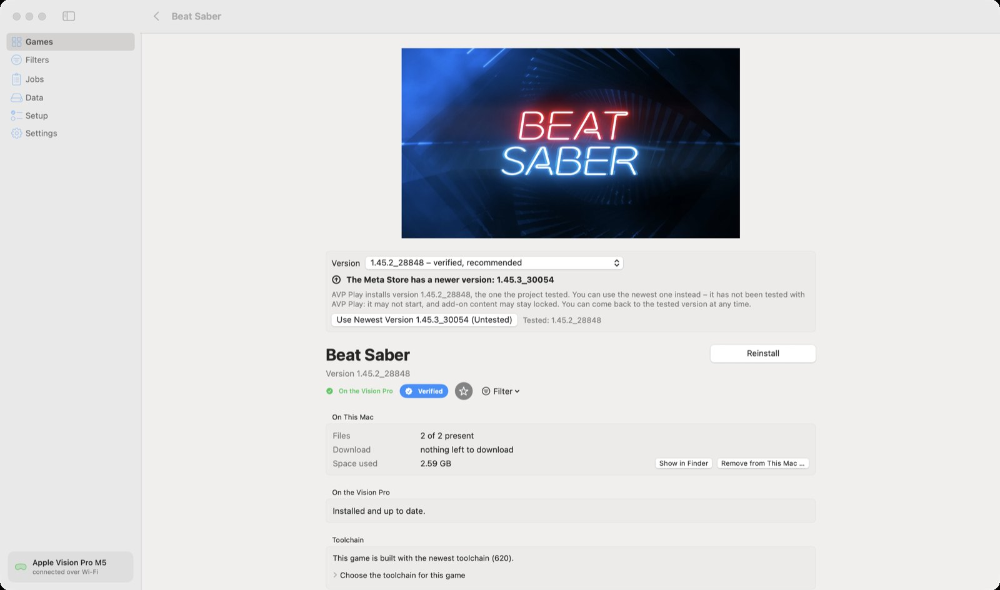
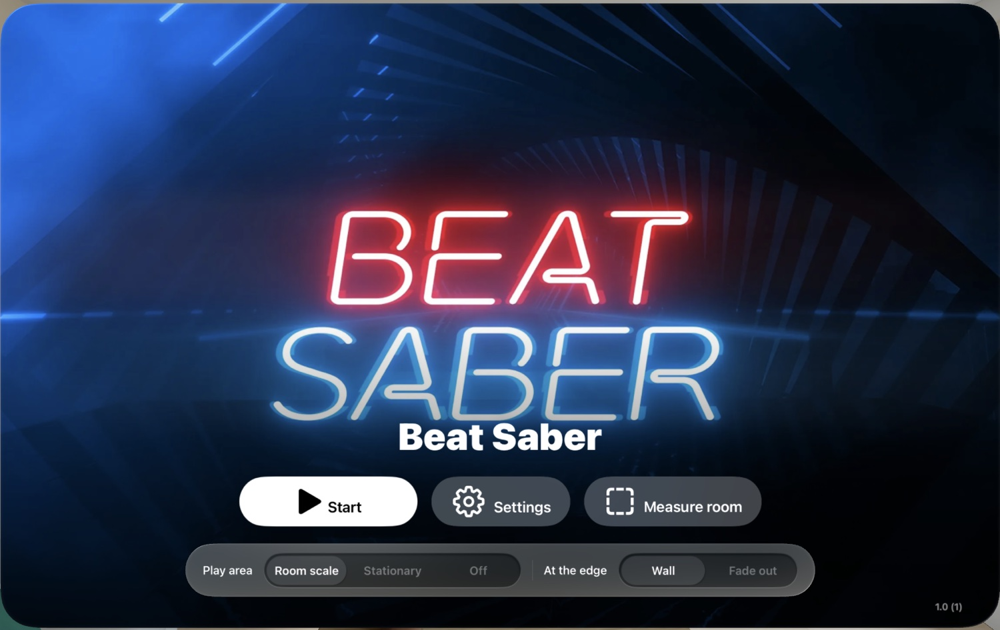

# AVP Play

AVP Play is a Mac app that installs VR games **you already own** on your Apple Vision Pro.

It downloads your purchased Quest games from Meta with your own account, translates them on your Mac with the
[Klepton](https://github.com/shinyquagsire23/Klepton) toolchain, signs them with your own Apple developer
account and copies them to your headset. No game content is distributed with this project, and nothing is
downloaded that Meta does not confirm you have purchased.

**New here?** The [user guide in the wiki](https://github.com/myMartek/avp-play/wiki) explains setup and everyday
use step by step, in simple words – in English and German.

**Like it?** AVP Play is free and stays free. If it saves you time or brings a game to your headset, you can
[buy me a coffee](https://buymeacoffee.com/martek).

<table>
  <tr>
    <td width="50%"></td>
    <td width="50%"></td>
  </tr>
  <tr>
    <td align="center"><sub>The games on the Mac – the ones the project tested first</sub></td>
    <td align="center"><sub>A game's page: version, files, what is on the Vision Pro</sub></td>
  </tr>
  <tr>
    <td colspan="2"></td>
  </tr>
  <tr>
    <td colspan="2" align="center"><sub>Beat Saber on the Apple Vision Pro: the start window before the game opens</sub></td>
  </tr>
</table>

> AVP Play is made by one person and tested on one Mac with one Vision Pro, plus what other players report.
> Expect rough edges, and please report what happens on your setup.

## How it works

1. **You pick a game you own.** AVP Play asks Meta (or Steam) whether your account owns it and downloads only
   what is confirmed – with your own sign-in, straight from the store.
2. **Your Mac translates it.** The Android build of the game is turned into a visionOS app by the
   [Klepton](#the-toolchain) toolchain, which comes with AVP Play.
3. **It is signed with your own Apple account** and copied to your Vision Pro – over Wi-Fi, or much faster over
   a USB cable on the Developer Strap.
4. **You play.** Every game opens with the same start window: *Start*, *Settings* for picture, play area and
   controls, and the room measured once for all games.

Every Quest game of the Meta Store is listed in the app with a label: **Verified** (tested by the project, with
a recipe in [`recipes/`](recipes)), **Community Verified** (players report it runs, or it runs with a fix a player
sent in), **Untested** or **Incompatible**. An untested game you own can be tried – most need adjustments before
they run. Say with one click how it went, or let an AI coding assistant try to fix it and send the fix in for
review; that is how the list grows.

Along the way the app keeps your saved games on your Mac, can keep the downloads on an external disk, shows
mixed-reality games in your own room, and updates itself from this repository's releases. The
[wiki](https://github.com/myMartek/avp-play/wiki) has the details.

## What you need

| | |
|---|---|
| Mac | Apple silicon, macOS 14 or later, [Xcode](https://apps.apple.com/app/xcode/id497799835) with its visionOS platform |
| Vision Pro | paired with Xcode, Developer Mode on, on the same Wi-Fi as the Mac |
| Apple account | an Apple developer team signed in to Xcode. A free account works with Apple's limits (a game opens for 7 days after it is installed, installing it again renews it; 3 apps at a time); the paid [Apple Developer Program](https://developer.apple.com/programs/) has none |
| Meta / Steam account | the account that owns the games – Meta for the Meta Store, Steam for games bought there |
| Controllers | what the game expects – mostly tracked controllers; an ordinary gamepad works together with your hands |
| Disk space | games are large, from a few hundred MB to over 70 GB, on the Mac and again on the headset |

## Install

1. Download `AVP-Play-<version>.dmg` from the [latest release](../../releases/latest), open it and drag
   **AVP Play** into Applications.
2. Open it. The **Setup** page checks Xcode, the Vision Pro, your Apple team and your store accounts, and says
   what to do for anything missing.
3. Pick a game under **Games** and click **Install**. The **Jobs** page shows each step; a job can be stopped
   and resumed at any time without losing what was downloaded.

## Your accounts and your data

- **Sign-ins go to the stores' own tools** – Meta's `ovr-platform-util` and Valve's SteamCMD, both downloaded
  from their makers. What you type goes to those tools and is not stored; Meta's token stays in the macOS keychain
  and is sent only to Meta. Game pictures come from the stores' public pages, without your sign-in.
- **Only what you own.** Ownership is asked before anything is downloaded, add-ons only for confirmed purchases.
  Requests stop at the first unexpected answer; the app never probes what a store might hand out.
- **Your games stay yours.** Files, builds and saved games live on your Mac and your headset. Nothing is shared
  with this project.
- **The project's catalogue service** (`avpplay.martek.de`) knows the list of games and what players report. It
  gets what you search for, the games whose page you open, the reports you choose to send, and – a little
  telemetry out of curiosity – once a day that the app is in use and once per game that it was installed, with no
  identifier of you or your devices. All of it can be turned off in Settings. There is no account with this
  project.

## Build it yourself

```bash
git clone https://github.com/myMartek/avp-play.git
cd avp-play/core
swift test                      # the library's tests
tools/make-app.sh               # builds ../dist/AVP Play.app (ad-hoc signed, for this Mac only)
```

`make-app.sh` bundles the newest `dist/klepton-toolchain-*.tar.gz` (with its `.json`) – take both from a release.
`core/Sources/AVPPlayCore` is the library, `AVPPlayApp` the Mac app, `avpplay` a command-line tool with the same
functions. The recipe format is in [docs/recipes.md](docs/recipes.md); how to report a problem or contribute is in
[CONTRIBUTING.md](CONTRIBUTING.md).

## The toolchain

Games are translated by a fork of [Klepton](https://github.com/shinyquagsire23/Klepton) by Max Thomas (MIT),
extended for the games AVP Play runs. The fork lives at [myMartek/Klepton](https://github.com/myMartek/Klepton)
(branch `avp-play`, one tag `toolchain-N` per release); changes to the runtime are welcome there as pull
requests. The package that ships with the app holds the fork's complete source with prebuilt ANGLE and MoltenVK
and their licences – see [THIRD-PARTY.md](THIRD-PARTY.md).

## Support the project

AVP Play is made in spare time and costs nothing to use. If you would like to say thanks, you can support it here:

<a href="https://buymeacoffee.com/martek"></a>

Reports and fixes from the app help just as much – see *Community Verified* below.

## Thanks

- **Max Thomas** for [Klepton](https://github.com/shinyquagsire23/Klepton), the ground all of this stands on.
- **[rebelancap](https://github.com/rebelancap)**, who offered the fixes of their own Klepton fork
  ([issue 16](https://github.com/myMartek/avp-play/issues/16)): foveated rendering for Vulkan games, large Unreal
  libraries, the OpenGL path, haptics, sound, and some 160 calls of Meta's headset interface.
- **[Glovebox](https://github.com/glovebox-vr/glovebox)**, which brings Half-Life: Alyx to the Vision Pro and
  published all of it under the MIT licence: shaders prepared before the game starts, Steam Cloud saves, the fix
  for flashing eyes and more came from there – each named in the source where it lives.
- **Everyone who sent in a fix or a report** – the *Community Verified* games are their work.

## Legal

AVP Play is an independent open-source project. It is **not affiliated with, endorsed by or supported by Apple,
Meta, or the publishers of any game**. Apple Vision Pro, Meta Quest and the names of the games are trademarks
of their respective owners.

It is meant for one thing: playing games you have bought, on a headset you own. It contains no game content and
does not remove or bypass purchase checks – it asks Meta what you own and installs only that. Whether using
your purchases this way is permitted by the terms of the stores and games involved is for you to check; you use
this software at your own risk. See [LICENSE](LICENSE) (MIT) for the terms of this project itself.
