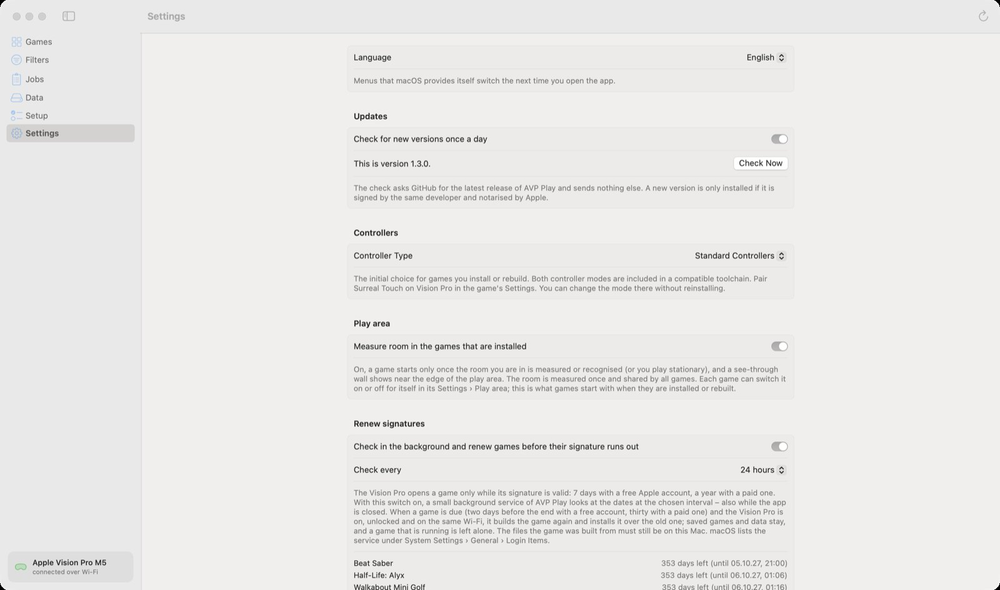
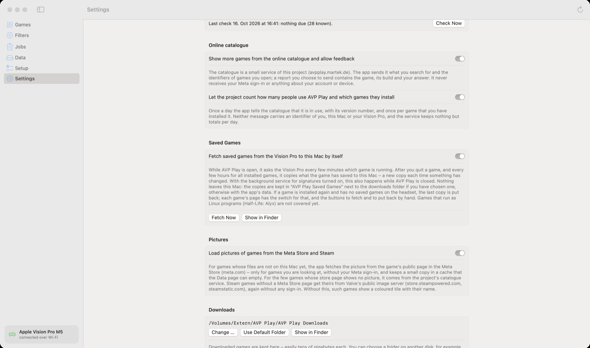
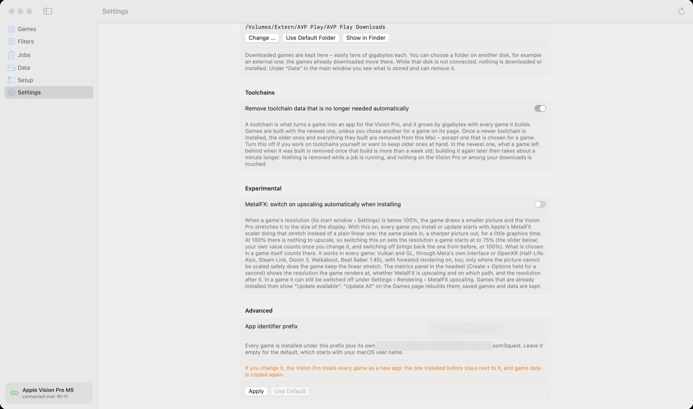

🏠 [Übersicht / Overview](README.md) · 🇩🇪 [Deutsche Fassung](Einstellungen-der-App.md)

# App settings

The settings of AVP Play on the Mac. The settings of a single game are on the Vision Pro – see [On the Vision Pro](On-the-Vision-Pro.md).

| Setting | What it does | Default |
|---|---|---|
| **Language** | English, German or same as macOS | Same as macOS |
| **Updates** | Ask GitHub once a day whether there is a new version of AVP Play. **Check Now** checks right away. A new version is only installed if it is signed by the same developer and notarised by Apple. | on |
| **Controllers** | Which controllers newly installed games expect first: *Standard Controllers* or *Surreal Touch*. You can change it in each game at any time. | Standard Controllers |
| **Play area** | *Measure room in the games that are installed.* When on, newly installed games check your room before they start. See [Play area](Play-Area.md). | on |
| **Renew signatures** | Check in the background and sign games again before they run out (important with a free Apple account: 7 days). **Check every** sets how often. Below, you see for each game how long it still runs. | off |
| **Online catalogue** | Show more games from the catalogue and allow feedback ("It works"). The catalogue only gets search terms and the IDs of games you open – never your sign-in. | on |
| **Usage counting** | Tell the project anonymously how many people use AVP Play and which games they install. No identifier of you or your device. | on |
| **Saved Games** | Fetch saved games from the Vision Pro to this Mac by itself. **Fetch Now** backs up right away. | on |
| **Pictures** | Load game pictures from the Meta Store and Steam (without signing in). Otherwise the app shows coloured tiles. | on |
| **Downloads** | Folder for downloaded games, as under [Data](Data.md). | – |
| **Toolchains** | Remove toolchain data that is no longer needed automatically. Saves many gigabytes. | on |
| **Experimental: MetalFX** | Newly installed games start with MetalFX upscaling and a lower resolution (75 % by default). This can make games smoother. | off |
| **Advanced: App identifier prefix** | Only change it if the help tells you to. Afterwards the Vision Pro sees every game as a new app. | empty |

## Other menu items

- **File › Export Game List …** and **Fetch Saved Games from the Vision Pro**
- **AVP Play › Check for Updates …**
- **Help › Report a Problem …** – creates an anonymous report you can copy and paste on GitHub. The app itself sends nothing.

---

➡️ [On the Vision Pro](On-the-Vision-Pro.md)
