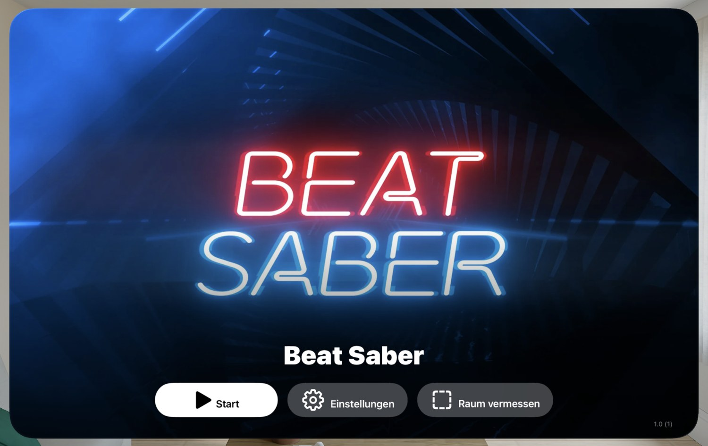
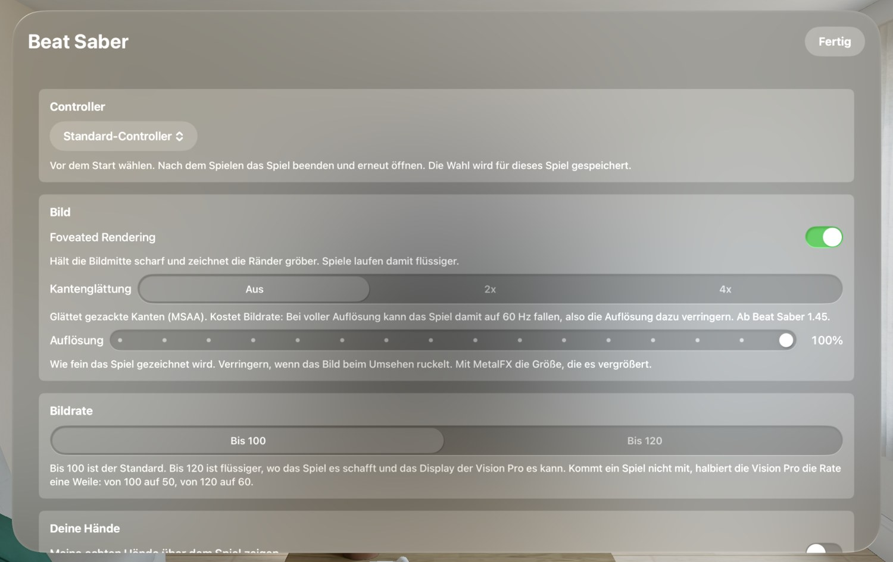
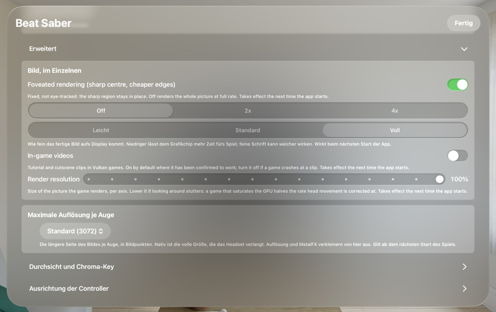
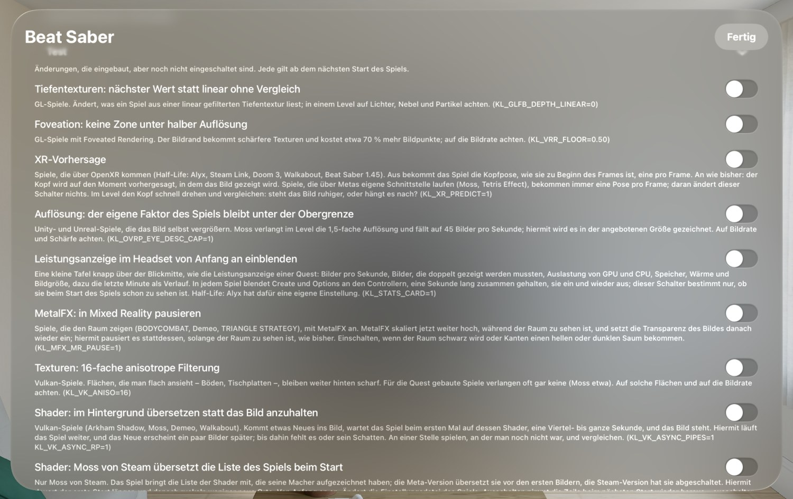

🏠 [Übersicht / Overview](README.md) · 🇬🇧 [English version](On-the-Vision-Pro.md)

# Auf der Vision Pro

Jedes Spiel, das AVP Play installiert, ist auf der Vision Pro eine eigene App. Du findest es in der App-Übersicht wie jede andere App.

## Das Startfenster

Wenn du ein Spiel öffnest, erscheint zuerst ein Fenster mit dem Bild und dem Namen des Spiels.

- **Starten** – startet das Spiel. Das Fenster schließt sich, sobald das Spiel läuft.
- **Einstellungen** – die Einstellungen dieses Spiels (siehe unten).
- **Raum vermessen** – deinen Spielbereich festlegen (siehe [Spielbereich](Spielbereich.md)). Nur da, wenn der Spielbereich in diesem Spiel an ist.
- Unten rechts steht die Version des Spiels und der Toolchain.

**Beim ersten Start** übersetzen viele Spiele ihre Grafik vor („Grafik wird vorbereitet: X von Y“). Das dauert beim ersten Mal einige Minuten, danach nur Sekunden. Einfach warten – das Spiel startet dann von selbst.

**Spiel beenden:** Drück die **Digital Crown**. Das Spiel beendet sich kurz darauf von selbst. Beim nächsten Öffnen startet es neu – es gibt kein Pausieren und Weitermachen im Hintergrund.

**Einstellungen ändern:** Die meisten Einstellungen gelten ab dem nächsten Start. Also: Spiel beenden, öffnen, **Einstellungen** ändern, **Starten**.

---

## Die Einstellungen eines Spiels

Jedes Spiel hat seine eigenen Einstellungen. Was du in Beat Saber einstellst, gilt nicht für Walkabout.

### Controller

**Controllertyp:** *Standard-Controller* (PlayStation-VR2-Sense-Controller, Gamecontroller und Hände) oder *Surreal Touch*. Vor dem Starten wählen. Die Wahl gilt nur für dieses Spiel.

### Bild

- **Foveated Rendering** – hält die Bildmitte scharf und zeichnet die Ränder gröber. Spiele laufen damit flüssiger. Bei manchen Spielen gibt es dafür Stufen von *Aus* bis *Sehr stark*.
- **Kantenglättung** – glättet treppenartige Kanten (nur bei manchen Spielen, z. B. Beat Saber ab 1.45). Kostet Leistung – dann am besten die Auflösung etwas senken.
- **Auflösung** – wie fein das Spiel gezeichnet wird (50–100 %). Ruckelt das Bild beim Umsehen, etwas senken.
- **MetalFX-Hochskalieren** – steht auf der Vision Pro direkt unter der Auflösung. Macht das Bild schärfer, wenn die Auflösung unter 100 % liegt. Schaltest du es bei 100 % ein, stellt die App die Auflösung auf 75 %. Das Umschalten wirkt sofort.

### Bildrate

- **Bis 100** (Standard) – am stabilsten. Wo das Spiel nichts zeichnet, ist es schwarz.
- **Bis 120** – flüssiger, wenn das Spiel das schafft.

Schafft ein Spiel die Bildrate nicht, halbiert die Vision Pro sie für eine Weile (von 100 auf 50, von 120 auf 60). Spiele mit Mixed Reality haben diese Wahl nicht.

### Deine Hände

**Meine echten Hände über dem Spiel zeigen** – normalerweise aus, weil die meisten Spiele eigene Hände oder Controller zeichnen.

### Gamecontroller

Zeigt, ob ein normaler Gamecontroller (DualSense, Xbox) verbunden ist. Koppeln geht auf der Vision Pro unter **Einstellungen › Bluetooth**. Siehe [Steuerung](Steuerung.md).

### Spielbereich

- **Spielbereich in diesem Spiel verwenden** – an oder aus
- **Raumgröße** oder **Stationär / sitzend**
- **Am Rand:** *Virtuelle Wand*, *Raum einblenden* oder *Aus*
- **Raum vermessen**

Alles dazu auf der Seite [Spielbereich](Spielbereich.md).

### Spielername, Sprache des Spiels

- **Spielername** – bei Spielen, die einen Namen zeigen (z. B. Demeo).
- **Sprache des Spiels** – in welcher Sprache das Spiel startet (Gerätesprache oder Englisch).

### Erweitert

Hier stehen Einstellungen, die du zum Spielen nicht brauchst:

- **Bild, im Einzelnen** – unter anderem **Ausgabe aufs Display** (*Leicht*, *Standard*, *Voll*): wie fein das fertige Bild auf das Display kommt. *Leicht* lässt dem Grafikchip mehr Zeit für das Spiel.
- **Maximale Auflösung je Auge** – die größte Bildgröße. Über der getesteten Grenze kann das Spiel ruckeln oder nicht starten.
- **Durchsicht und Chroma-Key**, **Ausrichtung der Controller** – für Bastler.
- **Mikrofon** – bei Spielen mit Sprachchat.
- **Test** – Schalter für Verbesserungen, die eingebaut, aber noch nicht für alle eingeschaltet sind. Manche sind bei einzelnen Spielen schon an (dann steht das dabei). Einer davon: **Leistungsanzeige im Headset von Anfang an einblenden**.
- **Diagnose** – das Protokoll des Spiels. **Protokoll weitergeben** schickt es zum Beispiel per AirDrop an deinen Mac – nützlich, wenn du ein Problem meldest. *Aufzeichnen, worauf das Spiel wartet* hilft bei Spielen, die im Ladebildschirm hängen bleiben.

---

## Besonderheiten einzelner Spiele

### Walkabout Mini Golf

- **Alle Putter und Bälle freischalten** – schaltet alle verlorenen Bälle, den Foxhunt-Putter und erspielte Homestar-Feiern frei. Geht erst, nachdem das Spiel einmal gestartet wurde. Kann nicht rückgängig gemacht werden (die App legt aber vorher eine Sicherung an).
- **Mikrofon** – damit dich andere im Mehrspieler-Sprachchat hören. Die Vision Pro fragt einmal nach der Erlaubnis.

### Half-Life: Alyx

- **Steam Cloud** – melde dich hier im Spiel mit deinem Steam-Konto an, damit deine Spielstände mit Steam abgeglichen werden. Die Anmeldung bestätigst du in der Steam-App auf dem Handy.
- **Grafik** – Voreinstellungen *Flüssig*, *Ausgewogen* (Standard), *Scharf* oder *Eigene*.
- **Laufgeschwindigkeit**, **Sprache** (inklusive deutscher Stimmen, wenn installiert).

---

➡️ [Spielbereich (Raum vermessen)](Spielbereich.md)
