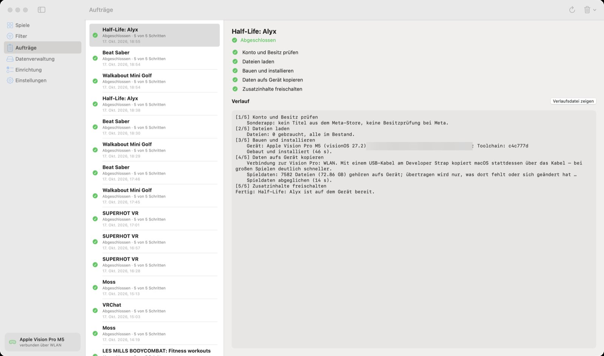

🏠 [Übersicht / Overview](README.md) · 🇬🇧 [English version](Jobs.md)

# Aufträge

Jedes Installieren, Herunterladen oder Aktualisieren ist ein **Auftrag**. Unter **Aufträge** siehst du alle – links die Liste, rechts die Einzelheiten.

## Die fünf Schritte

1. **Konto und Besitz prüfen** – gehört dir das Spiel?
2. **Dateien laden** – mit Fortschritt und geschätzter Restzeit
3. **Bauen und installieren** – der Mac übersetzt das Spiel und spielt es auf die Vision Pro
4. **Daten aufs Gerät kopieren** – die großen Spieldaten kommen auf die Vision Pro (mit USB-Kabel viel schneller als über WLAN)
5. **Zusatzinhalte freischalten** – gekaufte Erweiterungen

## Reihenfolge

- Es läuft **immer nur ein Auftrag** gleichzeitig. Die anderen warten.
- Wartende Aufträge laufen **von unten nach oben**. Der neueste steht oben.
- Du kannst wartende Aufträge **verschieben**: mit der Maus ziehen oder per Rechtsklick *Nach oben (kommt später dran)* / *Nach unten (kommt früher dran)*.
- Solange ein Auftrag läuft, bleibt der Mac wach.

## Wenn etwas schiefgeht

Ein angehaltener Auftrag zeigt den Kasten **Woran es lag** mit einer Erklärung und oft einem passenden Knopf (zum Beispiel **Einrichtung öffnen**).

- **Fortsetzen** macht dort weiter, wo der Auftrag stehen geblieben ist. Schon Geladenes oder Kopiertes bleibt erhalten.
- **Abbrechen** stoppt den Auftrag.
- **Verlaufsdatei zeigen** öffnet das komplette Protokoll.
- **Dieses Problem melden …** erstellt einen anonymen Bericht für GitHub (ohne Namen, Konten oder Gerätekennungen).

Die häufigsten Gründe und Lösungen stehen unter [Hilfe und FAQ](Hilfe-und-FAQ.md).

## App beenden während eines Auftrags

Die App fragt nach. Beendest du sie trotzdem, wird der Auftrag *unterbrochen* und lässt sich beim nächsten Öffnen mit **Fortsetzen** weiterführen.

## Liste aufräumen

Oben rechts im Menü **Leeren** (Papierkorb) kannst du abgeschlossene oder abgebrochene Aufträge aus der Liste nehmen. Geladene Dateien und die Spiele auf der Vision Pro bleiben dabei unberührt.

---

➡️ [Datenverwaltung](Datenverwaltung.md)
