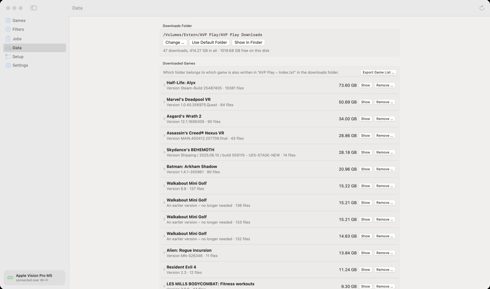

🏠 [Übersicht / Overview](README.md) · 🇩🇪 [Deutsche Fassung](Datenverwaltung.md)

# Data

Games are big. Under **Data** you see what is stored on your Mac and can free up space.

## Downloads folder

All downloaded game files are kept here. With **Change …** you can choose another folder – for example on an **external drive**. The app then moves everything there (with a progress bar) and only deletes a game at the old place once it has arrived completely.

If the external drive is not connected, the app doesn't download or install anything – and tells you so.

**Use Default Folder** goes back to the standard place on the Mac.

## Downloaded games

Each row is a game with its size.

- **Show** – open it in the Finder
- **Remove …** – delete the files from the Mac

If an entry says *An earlier version – no longer needed* or *Not used by any game in the list*, you can usually remove it safely.

**Important:** removing only deletes on the Mac. An installed game stays on the Vision Pro and keeps running. For the next update, the app simply downloads the files again.

**Export Game List …** saves a list of your downloaded and purchased games as a text file.

## Other data on this Mac

- **Toolchains** – they grow with every game that is built. **Remove Older Ones** deletes old versions nothing needs any more.
- **Left over from a Steam download** – half-downloaded Steam files. A new download continues with them; otherwise you can remove them.
- **Pictures from the Meta Store** – preview pictures. The app keeps them below 300 MB by itself.

---

➡️ [App settings](App-Settings.md)
