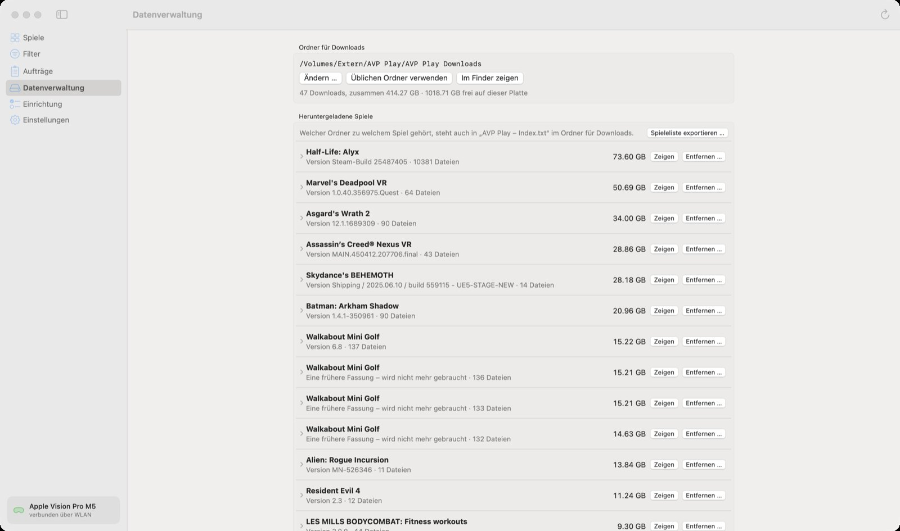

🏠 [Übersicht / Overview](README.md) · 🇬🇧 [English version](Data.md)

# Datenverwaltung

Spiele sind groß. Unter **Datenverwaltung** siehst du, was auf deinem Mac liegt, und kannst Platz schaffen.

## Ordner für Downloads

Hier liegen alle geladenen Spieldateien. Mit **Ändern …** kannst du einen anderen Ordner wählen – zum Beispiel auf einer **externen Festplatte**. Die App zieht dann alles dorthin um (mit Fortschrittsbalken) und löscht am alten Ort erst, wenn ein Spiel vollständig angekommen ist.

Ist die externe Festplatte nicht angeschlossen, lädt und installiert die App nichts – sie sagt dir das auch.

**Üblichen Ordner verwenden** geht zurück zum Standardort auf dem Mac.

## Heruntergeladene Spiele

Jede Zeile ist ein Spiel mit seiner Größe.

- **Zeigen** – im Finder öffnen
- **Entfernen …** – die Dateien vom Mac löschen

Steht bei einem Eintrag *Eine frühere Fassung – nicht mehr gebraucht* oder *Von keinem Spiel der Liste gebraucht*, kannst du ihn meist bedenkenlos entfernen.

**Wichtig:** Entfernen löscht nur auf dem Mac. Ein installiertes Spiel bleibt auf der Vision Pro und läuft weiter. Für das nächste Update lädt die App die Dateien dann einfach neu.

**Spieleliste exportieren …** speichert eine Liste deiner geladenen und gekauften Spiele als Textdatei.

## Weitere Daten auf diesem Mac

- **Toolchains** – sie wachsen mit jedem gebauten Spiel. **Ältere entfernen** löscht alte Versionen, die nichts mehr braucht.
- **Reste eines Steam-Abrufs** – halb geladene Steam-Dateien. Ein neuer Download macht damit weiter; sonst kannst du sie entfernen.
- **Bilder aus dem Meta-Store** – Vorschaubilder. Die App hält sie von selbst unter 300 MB.

---

➡️ [Einstellungen der App](Einstellungen-der-App.md)
