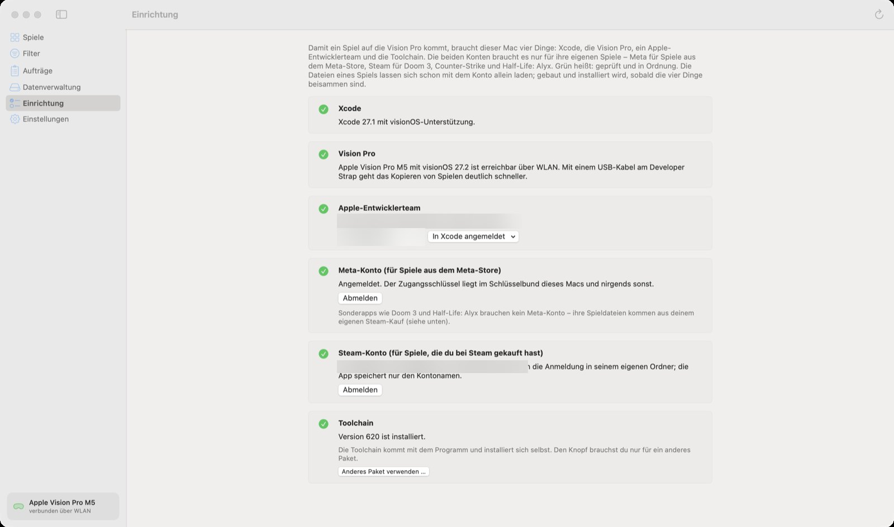

🏠 [Übersicht / Overview](README.md) · 🇬🇧 [English version](Setup.md)

# Einrichtung

Die Seite **Einrichtung** in der App zeigt, was noch fehlt. Ein **grüner Haken** heißt: geprüft und in Ordnung. Ein **orangefarbenes Dreieck** ist ein Hinweis (zum Beispiel: kostenloses Apple-Konto). Ein **leerer Kreis** heißt: fehlt noch.

Vier Dinge braucht der Mac immer: **Xcode**, die **Vision Pro**, ein **Apple-Entwicklerteam** und die **Toolchain**. Das **Meta-Konto** und das **Steam-Konto** brauchst du nur für die Spiele aus diesen Shops.

Nach jeder Änderung kannst du oben rechts auf **Neu prüfen** (Pfeil im Kreis) klicken.

---

## 1. Xcode installieren

Xcode ist Apples kostenloses Programm für Entwickler. AVP Play braucht es, um die Spiele für die Vision Pro zu bauen. Du musst Xcode nicht selbst bedienen – es muss nur installiert sein.

1. Öffne den **App Store** auf dem Mac und suche nach **Xcode**. Laden und installieren (das dauert, Xcode ist groß).
2. **Starte Xcode einmal.** Bestätige, was Xcode beim ersten Start fragt.
3. Falls die Einrichtung meldet, dass die **visionOS-Plattform** fehlt: In Xcode **Einstellungen › Components** öffnen und **visionOS** laden.

## 2. Apple-Konto in Xcode anmelden

1. In Xcode: **Einstellungen › Accounts** (auf Englisch „Accounts“).
2. Unten links auf **+** klicken, **Apple ID** wählen und mit deiner Apple-ID anmelden.
3. Zurück in AVP Play auf **Neu prüfen** klicken. Unter **Apple-Entwicklerteam** erscheint dein Name. Gibt es mehrere Teams, wählst du eines im Menü **In Xcode angemeldet**.

### Apple-Konto: kostenlos oder bezahlt?

Beides funktioniert.

| | Kostenloses Konto (deine normale Apple-ID) | Bezahlte Mitgliedschaft (Apple Developer Program) |
|---|---|---|
| Wie lange öffnet sich ein Spiel? | **7 Tage**, dann muss es neu signiert werden | **1 Jahr** |
| Wie viele Apps gleichzeitig auf der Vision Pro? | **Höchstens 3** | ohne Grenze |
| Neue Spiele pro Woche | höchstens 10 | ohne Grenze |
| Kosten | keine | Jahresgebühr bei Apple |

Mit dem kostenlosen Konto zeigt die App unten in der Seitenleiste ein kleines Feld „Kostenloses Konto“, zum Beispiel „2 von 3 Apps · je 7 Tage“.

**Tipp für das kostenlose Konto:** Schalte unter **Einstellungen › Signaturen erneuern** die automatische Erneuerung ein. Dann signiert die App deine Spiele von selbst neu, bevor die 7 Tage um sind – solange die Vision Pro an und im selben WLAN ist. Spielstände bleiben dabei erhalten.

**Einmal nötig mit dem kostenlosen Konto:** Auf der Vision Pro dem Entwickler vertrauen: **Einstellungen › Allgemein › VPN & Geräteverwaltung**, dein Apple-Konto wählen und **Vertrauen** antippen.

## 3. Vision Pro verbinden (einmalig)

1. Vision Pro und Mac ins **selbe WLAN** bringen.
2. Auf der Vision Pro: **Einstellungen › Allgemein › Entfernte Geräte** öffnen. Die Seite offen lassen.
3. Am Mac in Xcode: Menü **Window › Devices and Simulators** öffnen, die Vision Pro wählen, auf **Pair** klicken und den Code eingeben, den die Vision Pro anzeigt.
4. Auf der Vision Pro: **Einstellungen › Datenschutz & Sicherheit › Entwicklermodus** einschalten und neu starten, wenn sie danach fragt.

Danach muss die Vision Pro nur noch **an, entsperrt und im selben WLAN** sein. Unten in der Seitenleiste der App siehst du, ob sie verbunden ist („verbunden über WLAN“).

**Schneller kopieren:** Mit dem Developer Strap und einem USB-Kabel geht das Kopieren großer Spiele viel schneller. Die App nutzt das Kabel dann von selbst.

## 4. Meta-Konto anmelden (für Spiele aus dem Meta-Store)

Die Anmeldung läuft über ein kleines Werkzeug von Meta mit dem Namen **ovr-platform-util**. Es ist kostenlos, aber Meta bietet es nur auf der eigenen Seite an. Deshalb sind es zwei Klicks:

1. Klicke in der Einrichtung auf **1 Metas Download-Seite öffnen** und lade dort die **macOS**-Version.
2. AVP Play findet die Datei im Ordner **Downloads** von selbst (oder klicke auf **2 Download suchen**). Du musst die Datei nicht verschieben.
3. Klicke auf **Anmelden …** und folge den Fragen im Fenster (E-Mail, Passwort, ggf. Code).

Dein Zugang wird nur im Schlüsselbund deines Macs gespeichert und nur an Meta geschickt.

**Falls macOS das Werkzeug blockiert:** Öffne **Systemeinstellungen › Datenschutz & Sicherheit**, scrolle nach unten und klicke bei *ovr-platform-util* auf **Dennoch öffnen**. Dann in der App **Noch einmal** wählen.

## 5. Steam-Konto anmelden (optional)

Nur nötig für Spiele, die du bei Steam gekauft hast – zum Beispiel **Half-Life: Alyx**, **Doom 3**, **Counter-Strike**, oder wenn du **Walkabout Mini Golf** oder **Moss** bei Steam gekauft hast.

1. **SteamCMD von Valve holen** – das ist Valves eigenes Anmeldewerkzeug.
2. Falls angezeigt: **Rosetta installieren**. Valve liefert SteamCMD nur für Intel-Macs; Rosetta lässt es auf deinem Mac laufen.
3. **Anmelden …**: Steam-**Kontoname** eingeben (der Name, mit dem du dich anmeldest – nicht dein Profilname), dann Passwort. Ist Steam Guard an, gibst du den Code ein oder bestätigst in der Steam-App auf dem Handy.

Dein Passwort geht nur an SteamCMD. Die App speichert nur deinen Kontonamen.

## 6. Toolchain

Die **Toolchain** ist der Teil, der ein Quest-Spiel in eine Vision-Pro-App übersetzt. Sie kommt mit der App und installiert sich selbst. Hier musst du normalerweise nichts tun.

---

## Weiter

➡️ [Spiele finden und filtern](Spiele-und-Filter.md)
