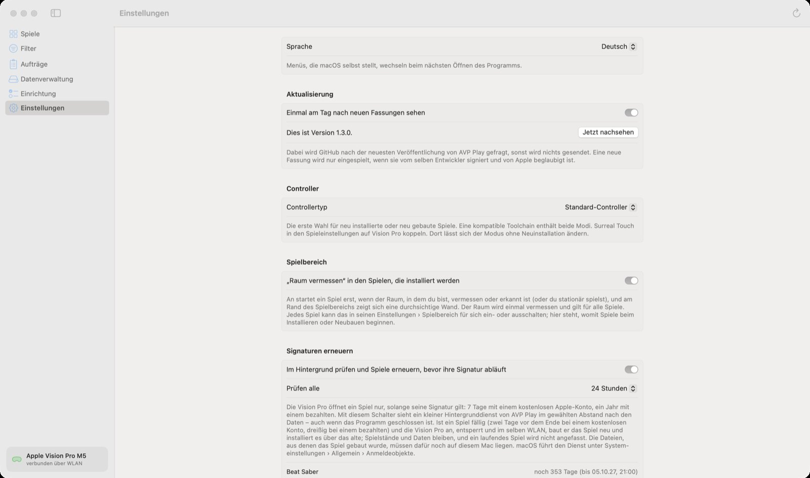
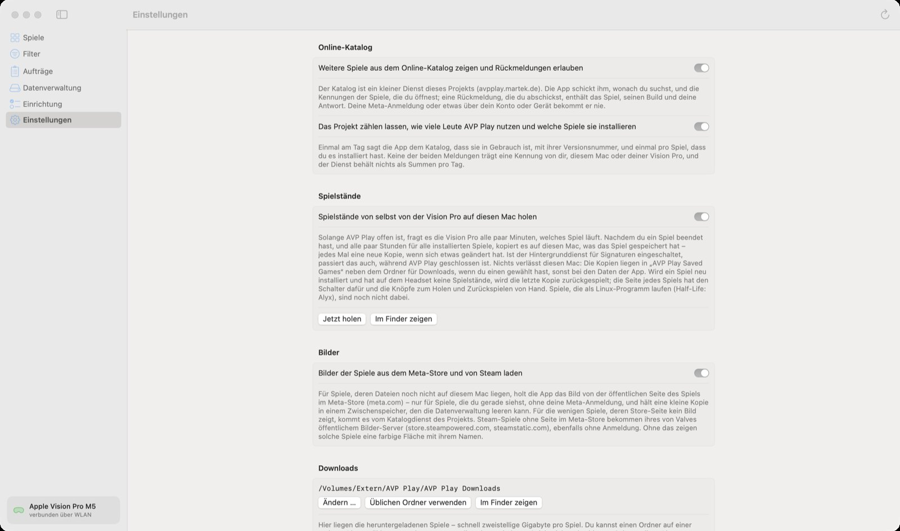
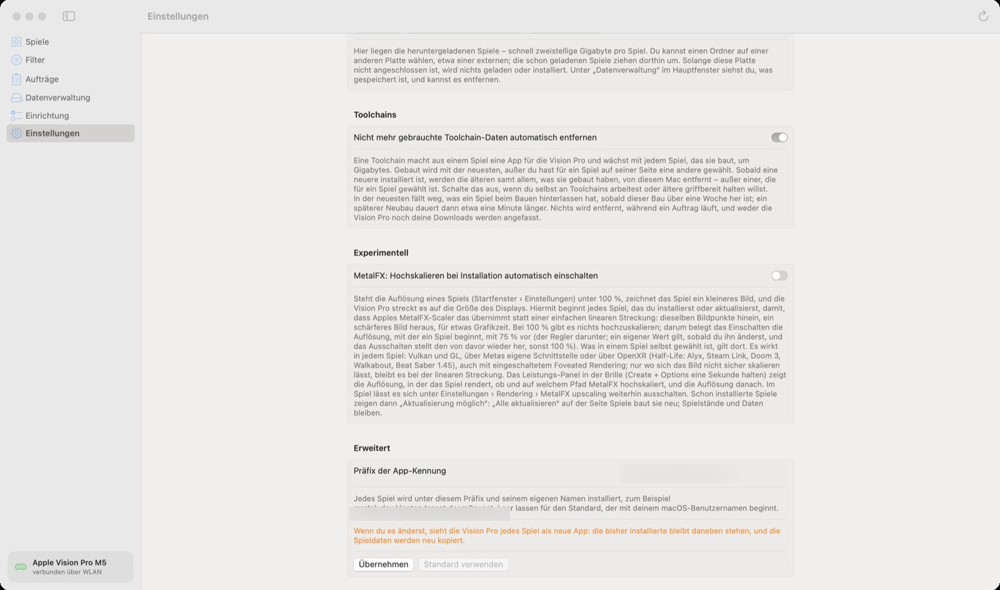

🏠 [Übersicht / Overview](README.md) · 🇬🇧 [English version](App-Settings.md)

# Einstellungen der App

Die Einstellungen von AVP Play auf dem Mac. Die Einstellungen eines einzelnen Spiels findest du auf der Vision Pro – siehe [Auf der Vision Pro](Auf-der-Vision-Pro.md).

| Einstellung | Was sie macht | Standard |
|---|---|---|
| **Sprache** | Deutsch, Englisch oder wie macOS | Wie macOS |
| **Aktualisierung** | Einmal am Tag bei GitHub nach einer neuen Version von AVP Play sehen. **Jetzt nachsehen** prüft sofort. Eine neue Version wird nur eingespielt, wenn sie vom selben Entwickler signiert und von Apple beglaubigt ist. | an |
| **Controller** | Welche Controller neu installierte Spiele zuerst erwarten: *Standard-Controller* oder *Surreal Touch*. Im Spiel selbst lässt sich das jederzeit umstellen. | Standard-Controller |
| **Spielbereich** | *„Raum vermessen“ in den Spielen, die installiert werden.* Ist das an, prüfen neu installierte Spiele vor dem Start deinen Raum. Siehe [Spielbereich](Spielbereich.md). | an |
| **Signaturen erneuern** | Im Hintergrund prüfen und Spiele neu signieren, bevor sie ablaufen (wichtig beim kostenlosen Apple-Konto: 7 Tage). **Prüfen alle** legt fest, wie oft. Darunter siehst du für jedes Spiel, wie lange es noch läuft. | aus |
| **Online-Katalog** | Weitere Spiele aus dem Katalog zeigen und Rückmeldungen („Es läuft“) erlauben. Der Katalog bekommt nur Suchbegriffe und die Kennungen geöffneter Spiele – nie deine Anmeldung. | an |
| **Nutzung zählen** | Dem Projekt anonym mitteilen, wie viele Leute AVP Play nutzen und welche Spiele sie installieren. Ohne Kennung von dir oder deinem Gerät. | an |
| **Spielstände** | Spielstände von selbst von der Vision Pro auf den Mac holen. **Jetzt holen** sichert sofort. | an |
| **Bilder** | Spielbilder aus dem Meta-Store und von Steam laden (ohne Anmeldung). Sonst zeigt die App farbige Kacheln. | an |
| **Downloads** | Ordner für die geladenen Spiele, wie unter [Datenverwaltung](Datenverwaltung.md). | – |
| **Toolchains** | Nicht mehr gebrauchte Toolchain-Daten automatisch entfernen. Spart viele Gigabyte. | an |
| **Experimentell: MetalFX** | Neu installierte Spiele starten mit MetalFX-Hochskalieren und kleinerer Auflösung (Standard 75 %). Das kann Spiele flüssiger machen. | aus |
| **Erweitert: Präfix der App-Kennung** | Nur ändern, wenn die Hilfe es empfiehlt. Danach sieht die Vision Pro jedes Spiel als neue App. | leer |

## Weitere Menüpunkte

- **Ablage › Spieleliste exportieren …** und **Spielstände von der Vision Pro holen**
- **AVP Play › Nach Updates suchen …**
- **Hilfe › Ein Problem melden …** – erstellt einen anonymen Bericht, den du kopieren und auf GitHub einfügen kannst. Die App schickt selbst nichts.

---

➡️ [Auf der Vision Pro](Auf-der-Vision-Pro.md)
