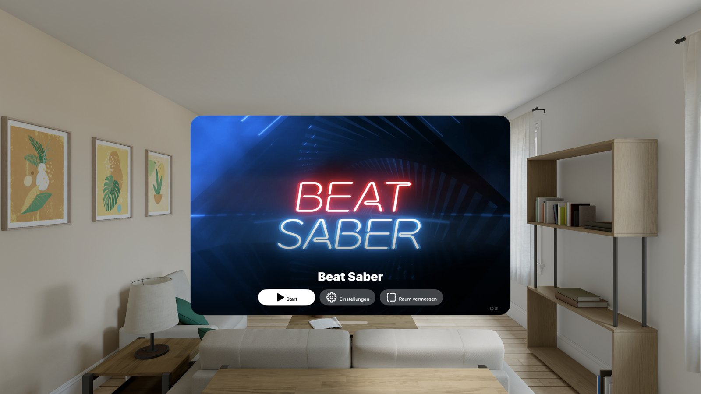

🏠 [Übersicht / Overview](README.md) · 🇬🇧 [English version](Getting-Started.md)

# Erste Schritte

## Was ist AVP Play?

AVP Play ist ein Programm für den Mac. Es holt VR-Spiele, die du für die Meta Quest gekauft hast, und macht daraus Apps für deine Apple Vision Pro.

Das passiert in vier Schritten – alles erledigt die App für dich:

1. **Prüfen:** Die App fragt bei Meta (oder Steam), ob dir das Spiel gehört. Nur dann geht es weiter.
2. **Laden:** Die Spieldateien werden mit deinem eigenen Konto auf den Mac geladen.
3. **Bauen:** Der Mac übersetzt das Spiel für die Vision Pro und unterschreibt die App mit deinem Apple-Konto (das nennt man „signieren“).
4. **Übertragen:** Die fertige App wird auf deine Vision Pro kopiert. Dort findest du sie wie jede andere App.

AVP Play verteilt selbst keine Spiele. Du bekommst nur, was du gekauft hast.

## Was du brauchst

| | |
|---|---|
| **Mac** | Ein Mac mit Apple-Chip (M1 oder neuer), macOS 14 oder neuer |
| **Xcode** | Apples kostenloses Entwickler-Programm aus dem App Store, mit der visionOS-Erweiterung |
| **Apple Vision Pro** | Im selben WLAN wie der Mac, mit eingeschaltetem Entwicklermodus |
| **Apple-Konto** | Deine normale Apple-ID reicht (kostenlos). Mit der bezahlten Entwickler-Mitgliedschaft fallen ein paar Grenzen weg – siehe [Einrichtung](Einrichtung.md#apple-konto-kostenlos-oder-bezahlt). |
| **Meta-Konto** | Das Konto, mit dem du die Quest-Spiele gekauft hast |
| **Steam-Konto** *(optional)* | Nur für Spiele, die du bei Steam gekauft hast (z. B. Half-Life: Alyx, Doom 3) |
| **Speicherplatz** | Viel. Ein großes Spiel braucht 10 bis 75 GB auf dem Mac und noch einmal auf der Vision Pro. Eine externe Festplatte für den Mac geht auch. |
| **Controller** | Die meisten Spiele brauchen die PlayStation-VR2-Sense-Controller. Ein normaler Gamecontroller (DualSense, Xbox) funktioniert zusammen mit deinen Händen. |

## So geht es los

1. **App laden:** Lade `AVP-Play-1.3.0.dmg` von der [Download-Seite](https://github.com/myMartek/avp-play/releases/latest). Öffne die Datei und ziehe **AVP Play** in den Ordner **Programme**.
2. **App öffnen:** Beim ersten Start zeigt die App die Seite **Einrichtung**. Dort steht für jeden Punkt, ob er schon passt (grüner Haken) oder was noch fehlt. Wie du jeden Punkt erledigst, steht auf der Seite [Einrichtung](Einrichtung.md).
3. **Spiel aussuchen:** Unter **Spiele** suchst du ein Spiel aus und klickst auf **Installieren**. Mehr dazu unter [Spiele finden und filtern](Spiele-und-Filter.md).
4. **Warten:** Unter **Aufträge** siehst du, wie weit die Installation ist. Große Spiele brauchen beim ersten Mal eine Weile.
5. **Spielen:** Setz die Vision Pro auf und öffne das Spiel. Es erscheint ein Startfenster mit **Starten** und **Einstellungen**. Mehr dazu unter [Auf der Vision Pro](Auf-der-Vision-Pro.md).

## Welche Spiele laufen?

Nicht jedes Quest-Spiel läuft. Jedes Spiel braucht kleine Anpassungen, bevor es auf der Vision Pro funktioniert. An den Etiketten in der App siehst du, wie gut ein Spiel läuft:

- **Geprüft** (blau): Das Projekt hat das Spiel auf einer Vision Pro getestet.
- **Von Nutzern bestätigt** (grün): Mehr Leute melden „läuft“ als „läuft nicht“.
- **Ungetestet** (grau): Noch keine Meldungen. Probieren ist erlaubt – es kann aber gut sein, dass es nicht startet.
- **Inkompatibel** (rot): Läuft nach den Meldungen nicht.

Wenn ein Spiel nicht läuft, hilft die Seite [Hilfe und FAQ](Hilfe-und-FAQ.md).

## Weiter

➡️ [Einrichtung](Einrichtung.md)
