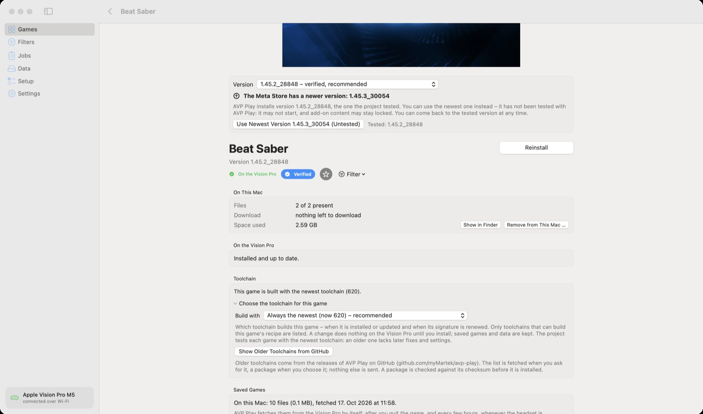
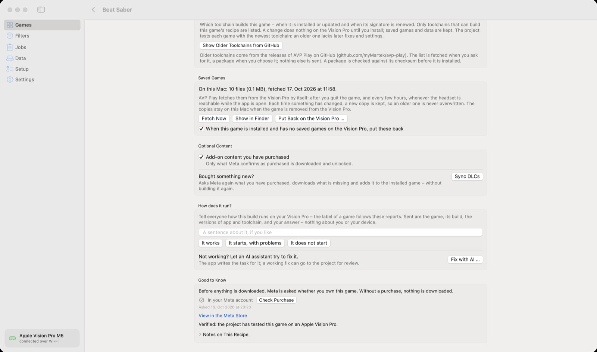

🏠 [Übersicht / Overview](README.md) · 🇩🇪 [Deutsche Fassung](Spielseite.md)

# A game's page

Click a game in the list to open its page. Here you install it, choose the version, back up saved games and report how it runs.

## The big button

Next to the name is the main button:

- **Install** – the game isn't on the Vision Pro yet.
- **Update** – there is a newer build (new toolchain or new game version). Saved games and data stay.
- **Reinstall** – everything is up to date; builds the game again anyway.

If the button is gray, the reason is written below it (for example "The Apple team ID is still missing" or "Not enough free space").

**Download Only** only downloads the files to the Mac – no Xcode, no Vision Pro needed. Installing later then works without downloading again.

## Purchased from (Meta Store or Steam)

Only for games sold in both stores (currently **Walkabout Mini Golf** and **Moss**). Choose where you bought the game. The app usually notices by itself: if you own the game only on Steam, it switches to Steam.

Important: the Meta and Steam versions are different apps with their own saved games. One cannot be installed over the other – remove the old one from the Vision Pro first. (Saved games AVP Play has already fetched to the Mac stay there.)

## Version

In the **Version** menu you choose the version of the game.

- **verified, recommended** – the project tested this version. Best choose this one.
- **newest in the store / untested** – newer versions from the Meta Store. They may work, or may not; add-on content may stay locked. You can go back to the verified version at any time.

When the store has a newer version, the app shows a note with the button **Use Newest Version … (Untested)**.

## On This Mac / On the Vision Pro

- **On This Mac:** how many files are already there, what is left to download and how much space the game uses. **Remove from This Mac …** deletes the downloaded files (the game on the Vision Pro stays).
- **On the Vision Pro:** whether the game is installed and up to date. With a free Apple account, it also says until when the game opens.

## Toolchain

Normally every game is built with the newest toolchain – which is good. Under **Choose the toolchain for this game** you can keep a game on an older toolchain, in case an update makes things worse for exactly this game. **Show Older Toolchains from GitHub** downloads older versions when you choose one.

This is for advanced users. When in doubt: **Always the newest – recommended**.

## Saved Games

AVP Play fetches your games' saved games to the Mac by itself – after you quit a game and every few hours. Every change is kept as a copy of its own.

- **Fetch Now** – back up right away
- **Show in Finder** – open the folder with the backups
- **Put Back on the Vision Pro …** – bring a backup back to the Vision Pro. Whatever is there now is copied to the Mac first, so nothing is lost. **Quit the game first.**
- The tick box below makes sure a newly installed game without saved games gets your latest backup automatically.

Half-Life: Alyx is not covered here – it uses Steam Cloud (see [On the Vision Pro](On-the-Vision-Pro.md#half-life-alyx)).

## Optional Content

- **Add-on content you have purchased** – for example song packs in Beat Saber or courses in Walkabout. Only what Meta (or Steam) confirms as purchased is downloaded.
- **Bought something new? › Sync DLCs** – asks Meta again, downloads only what is new and adds it to the installed game without rebuilding. Restart the game afterwards.
- **Languages** – in some games, extra languages are a separate download.
- **Special content** – for example the German voice-over (fan mod) for Half-Life: Alyx.

## How does it run?

Here you tell everyone how the game runs for you: **It works**, **It starts, with problems** or **It does not start** – with a sentence if you like. The labels in the game list follow these reports. Only the game, its version, the app and toolchain versions and your answer are sent – nothing about you or your device.

### Fix with AI

If a game doesn't work, you can let an AI assistant (for example ChatGPT or Claude) try to fix it:

1. Click **Fix with AI …**.
2. Tick what happens (crashes, stays black, wrong picture, controls don't work …), optionally describe it.
3. Click **Copy Task** and paste the text into your AI assistant.

AVP Play itself sends nothing. This is more for the curious with some patience.

## Good to Know

- **Check Purchase** – asks Meta (and Steam) right now whether you own the game. Useful right after buying it.
- **View in the Meta Store / View on Steam** – opens the store page.
- **Notes on This Recipe** – the project's notes on this exact game.

## Games whose files you provide yourself

**Doom 3**, **Counter-Strike** and **Half-Life: Alyx** don't come from the Meta Store. The app fetches their files from your Steam purchase (**Download from Steam**) – or you show it a folder that already has the files with **Choose Folder …**.

---

➡️ [Games from Steam](Steam-Games.md)
