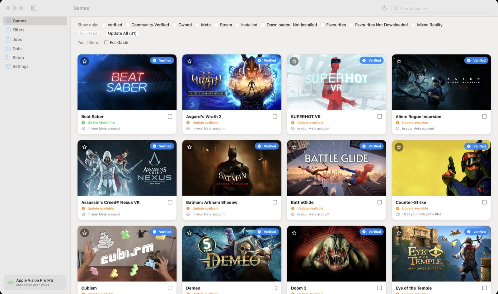
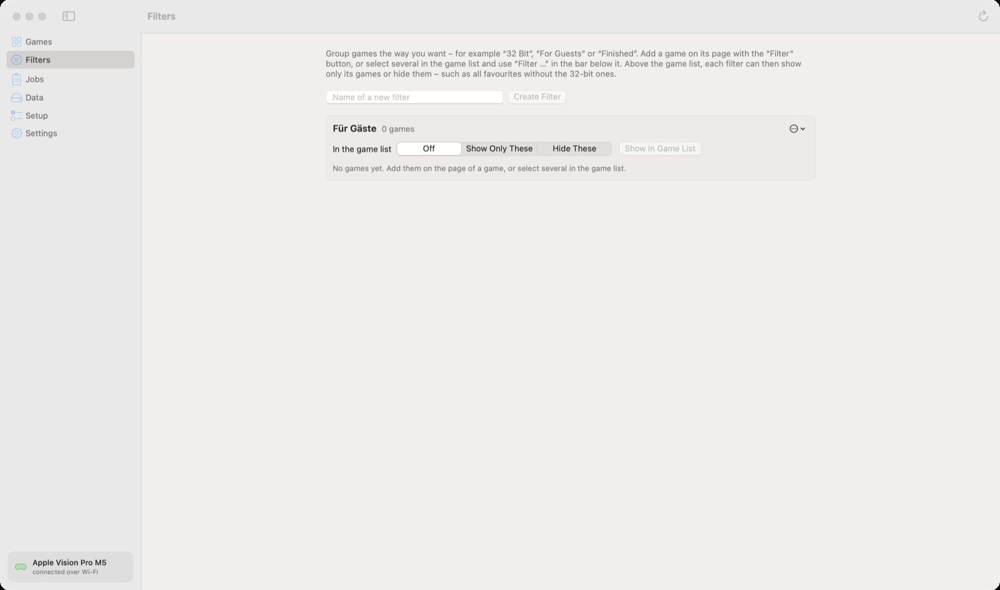

🏠 [Übersicht / Overview](README.md) · 🇩🇪 [Deutsche Fassung](Spiele-und-Filter.md)

# Finding and filtering games

Under **Games** you see every game AVP Play knows – the verified ones first, then the rest of the Meta Store. At the bottom, the list loads more games as you scroll.

## A game card

Each game has a card with:

- **Picture and name**
- **Star** at the top left: mark as favourite
- **Label** at the top right: *Verified*, *Community Verified*, *Untested*, *Incompatible* or *2D App* (2D apps such as Spotify or YouTube don't work – AVP Play is for VR games only)
- **State on the Vision Pro**, for example *On the Vision Pro*, *Update available*, *Not installed*
- **Ownership**, for example *In your Meta account* or *Not in your Steam account*
- **Checkbox** on the right: to select several games at once

Clicking a card opens the [game's page](Game-Page.md).

## Search

The **Search games** field is at the top right. Type part of a name. After a short pause, the app also searches the online catalogue with every game in the Meta Store.

## "Show only" filters

Above the list there are checkboxes. Each one shows only certain games. Several together make the list smaller.

| Filter | Shows only … |
|---|---|
| **Verified** | games the project has tested |
| **Community Verified** | games that other users report as working |
| **Owned** | games you own (Meta library and Steam account) |
| **Meta** | games from the Meta Store |
| **Steam** | games available on Steam (see [Games from Steam](Steam-Games.md)) |
| **Installed** | games on your Vision Pro |
| **Downloaded, Not Installed** | games whose files are on the Mac but not on the Vision Pro |
| **Favourites** | starred games |
| **Favourites Not Downloaded** | favourites that still need downloading |
| **Mixed Reality** | games where you see your real room around the game |

*Verified* and *Community Verified* together show both. The same goes for *Meta* and *Steam*.

**Owned** needs the Meta or Steam sign-in. The app reads your library at most once an hour (Meta) or once a day (Steam).

## Your own filters

Group games the way you like – for example "For guests", "32 Bit" or "Finished".

**To create a filter:**

1. Click **Filters** on the left.
2. Type a name and click **Create Filter**.

**To put a game in a filter:**

- On the game's page, click the **Filter** button and tick the filter, **or**
- tick several games in the game list and choose **Filter …** in the bar at the bottom.

**To use it:** Above the game list there is now a row **Your filters**. Clicking a filter cycles through **Off**, **Show Only These** and **Hide These**. Hidden filters are crossed out.

Example: tick *Favourites* and set the "32 Bit" filter to *Hide These* – you now see all favourites except the 32-bit games.

On the **Filters** page you can also rename a filter, delete it (the games stay) or save it as a list.

## Several games at once

Tick the checkboxes of several games. A bar appears at the bottom with:

- **Install** – downloads, builds and installs the games one after another
- **Download Only** – only downloads the files to the Mac (needs neither Xcode nor the Vision Pro)
- **Filter …** – put the games into one of your filters
- **Clear Selection**

## Update All

The **Update All (number)** button rebuilds every installed game for which there is a newer build – for example after an AVP Play update. Saved games and data on the Vision Pro stay.

## Export List

**Export List …** saves the games shown right now as a text file. It works when a filter such as *Installed*, *Favourites* or one of your own filters set to *Show Only These* is on.

---

➡️ [A game's page](Game-Page.md)
