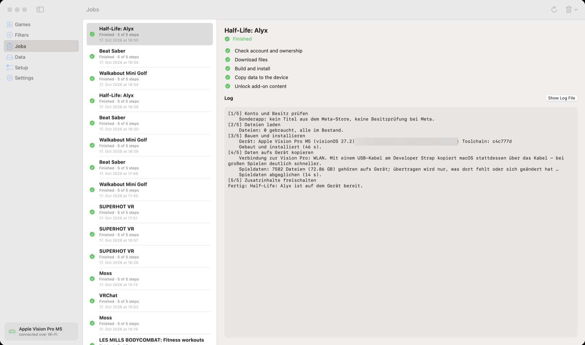

🏠 [Übersicht / Overview](README.md) · 🇩🇪 [Deutsche Fassung](Auftraege.md)

# Jobs

Every install, download or update is a **job**. Under **Jobs** you see them all – the list on the left, the details on the right.

## The five steps

1. **Check account and ownership** – do you own the game?
2. **Download files** – with progress and estimated time left
3. **Build and install** – the Mac translates the game and puts it on the Vision Pro
4. **Copy data to the device** – the big game data goes to the Vision Pro (much faster with a USB cable than over Wi-Fi)
5. **Unlock add-on content** – purchased extras

## Order

- **Only one job runs** at a time. The others wait.
- Waiting jobs run **from the bottom up**. The newest is at the top.
- You can **move** waiting jobs: drag them with the mouse, or right-click *Move Up (Runs Later)* / *Move Down (Runs Sooner)*.
- While a job runs, the Mac stays awake.

## When something goes wrong

A stopped job shows the **What Went Wrong** box with an explanation and often a matching button (for example **Open Setup**).

- **Resume** continues where the job stopped. Whatever was downloaded or copied is kept.
- **Cancel** stops the job.
- **Show Log File** opens the full log.
- **Report This Problem …** creates an anonymous report for GitHub (no names, accounts or device identifiers).

The most common causes and fixes are under [Help and FAQ](Help-and-FAQ.md).

## Quitting the app during a job

The app asks first. If you quit anyway, the job is *interrupted* and can be continued with **Resume** the next time you open the app.

## Clearing the list

The **Clear** menu (trash can, top right) takes finished or cancelled jobs off the list. Downloaded files and the games on the Vision Pro are not touched.

---

➡️ [Data](Data.md)
