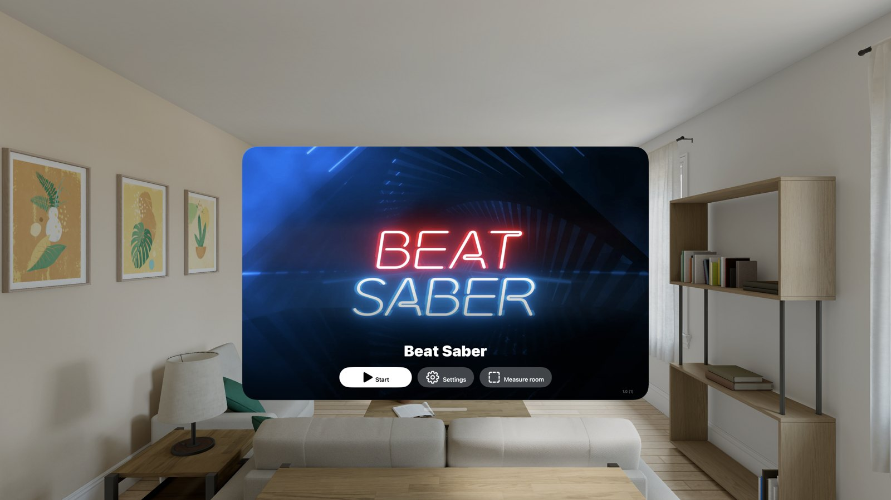
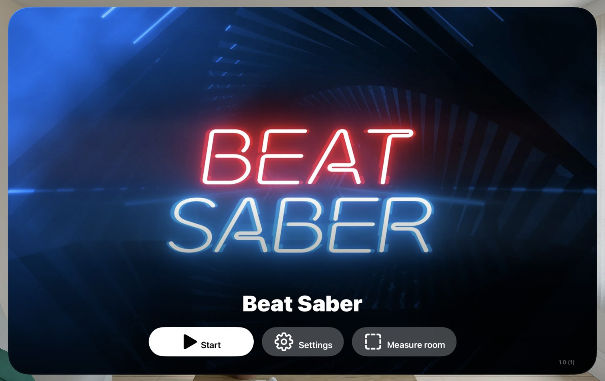
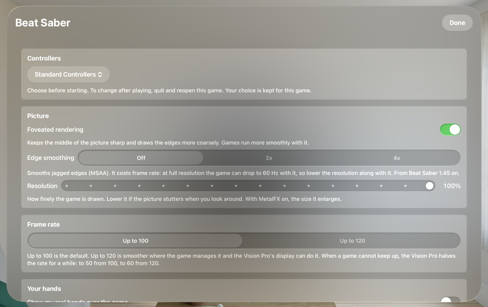
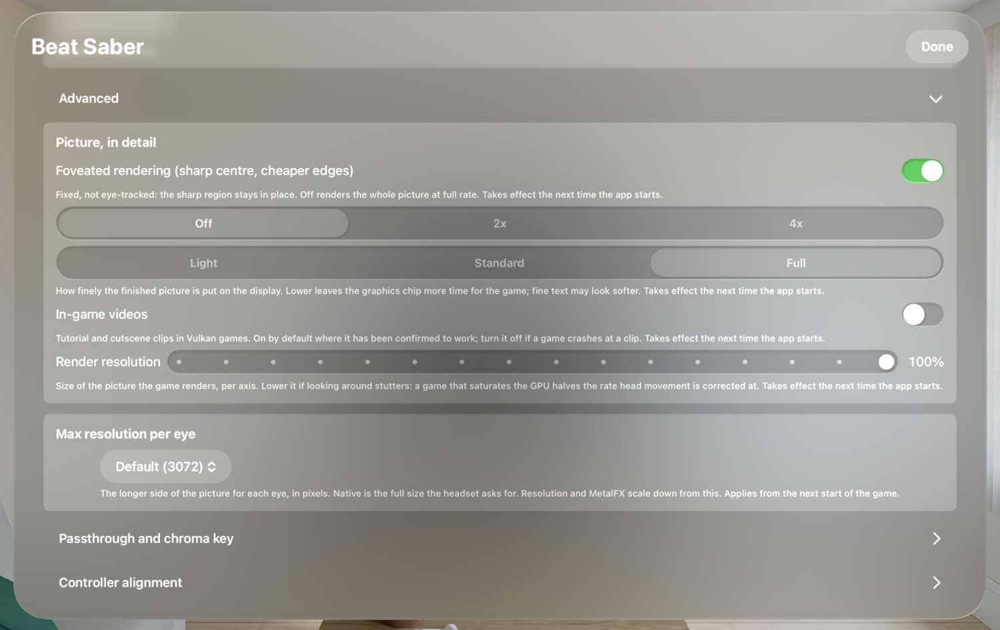
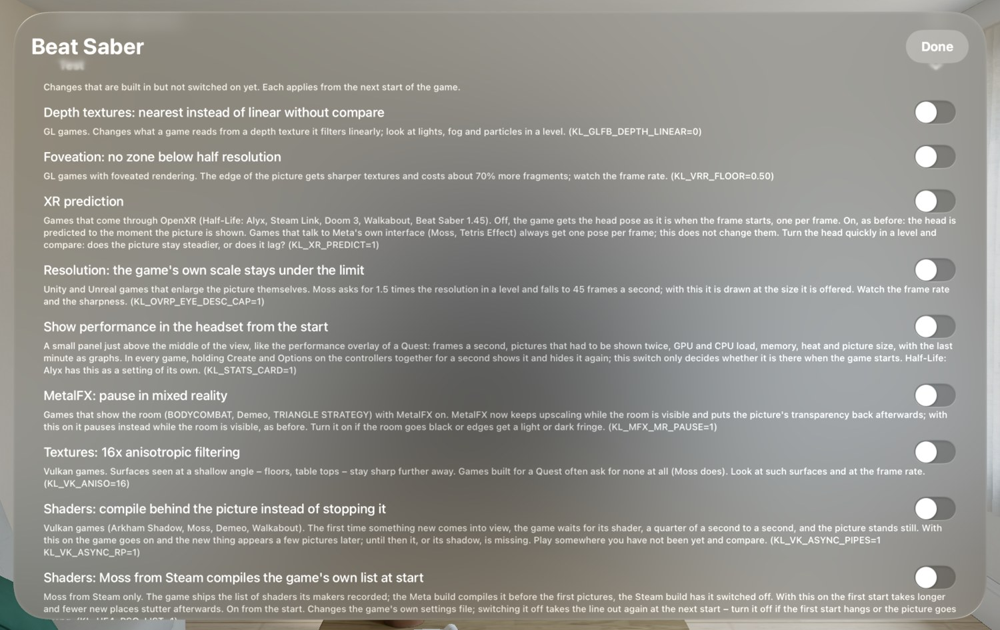

🏠 [Übersicht / Overview](README.md) · 🇩🇪 [Deutsche Fassung](Auf-der-Vision-Pro.md)

# On the Vision Pro

Every game AVP Play installs is an app of its own on the Vision Pro. You find it on the Home View like any other app.

## The start window

When you open a game, a window with the game's picture and name appears first.

- **Start** – starts the game. The window closes once the game is running.
- **Settings** – this game's settings (see below).
- **Measure room** – set up your play area (see [Play area](Play-Area.md)). Only shown when the play area is on in this game.
- Bottom right: the version of the game and of the toolchain.

**On the first start** many games prepare their graphics ("Preparing graphics: X of Y"). That takes a few minutes the first time and only seconds after that. Just wait – the game then starts by itself.

**Quitting a game:** Press the **Digital Crown**. The game ends itself shortly after. The next time you open it, it starts fresh – there is no pausing and resuming in the background.

**Changing settings:** Most settings apply from the next start. So: quit the game, open it, change **Settings**, **Start**.

---

## A game's settings

Each game has its own settings. What you set in Beat Saber doesn't apply to Walkabout.

### Controllers

**Controller Type:** *Standard Controllers* (PlayStation VR2 Sense controllers, game controllers and hands) or *Surreal Touch*. Choose before starting. The choice applies to this game only.

### Picture

- **Foveated rendering** – keeps the middle of the picture sharp and draws the edges more coarsely. Games run more smoothly with it. Some games offer levels from *Off* to *Very strong*.
- **Edge smoothing** – smooths jagged edges (only in some games, e.g. Beat Saber from 1.45). Costs performance – then best lower the resolution a little.
- **Resolution** – how finely the game is drawn (50–100 %). If the picture stutters when you look around, lower it a little.
- **MetalFX upscaling** – on the Vision Pro it sits right below Resolution. Sharpens the picture when the resolution is below 100 %. Turning it on at 100 % sets the resolution to 75 %. Switching takes effect at once.

### Frame rate

- **Up to 100** (default) – the most stable. Where the game draws nothing, it is black.
- **Up to 120** – smoother, where the game manages it.

When a game can't keep up, the Vision Pro halves the rate for a while (100 to 50, 120 to 60). Mixed-reality games don't have this choice.

### Your hands

**Show my real hands over the game** – normally off, because most games draw their own hands or controllers.

### Game controller

Shows whether an ordinary game controller (DualSense, Xbox) is connected. Pair it on the Vision Pro under **Settings › Bluetooth**. See [Controls](Controls.md).

### Play area

- **Use a play area in this game** – on or off
- **Room scale** or **Stationary / seated**
- **Near the edge:** *Virtual wall*, *Show the room* or *Off*
- **Measure room**

Everything about it is on the [Play area](Play-Area.md) page.

### Player name, game language

- **Player name** – for games that show a name (e.g. Demeo).
- **Game language** – which language the game starts in (device language or English).

### Advanced

Settings you don't need to play:

- **Picture, in detail** – including **Display output** (*Light*, *Standard*, *Full*): how finely the finished picture goes to the display. *Light* leaves the graphics chip more time for the game.
- **Max resolution per eye** – the largest picture size. Above the tested limit the game may stutter or not start.
- **Passthrough and chroma key**, **Controller alignment** – for tinkerers.
- **Microphone** – in games with voice chat.
- **Test** – switches for improvements that are built in but not yet on for everyone. Some are already on for single games (it says so). One of them: **Show performance in the headset from the start**.
- **Diagnostics** – the game's log. **Export log** sends it, for example by AirDrop, to your Mac – useful when you report a problem. *Record what the game waits for* helps with games that get stuck on a loading screen.

---

## Special features of single games

### Walkabout Mini Golf

- **Unlock all putters and balls** – unlocks every lost ball, the Foxhunt putter and earned Homestar celebrations. Works only after the game has been started once. Cannot be undone (the app makes a backup first, though).
- **Microphone** – so others hear you in multiplayer voice chat. The Vision Pro asks for permission once.

### Half-Life: Alyx

- **Steam Cloud** – sign in with your Steam account here in the game so your saved games are kept in step with Steam. You confirm the sign-in in the Steam app on your phone.
- **Graphics** – presets *Smooth*, *Balanced* (default), *Sharp* or *Custom*.
- **Walking speed**, **Language** (including German voices if installed).

---

➡️ [Play area (measure room)](Play-Area.md)
