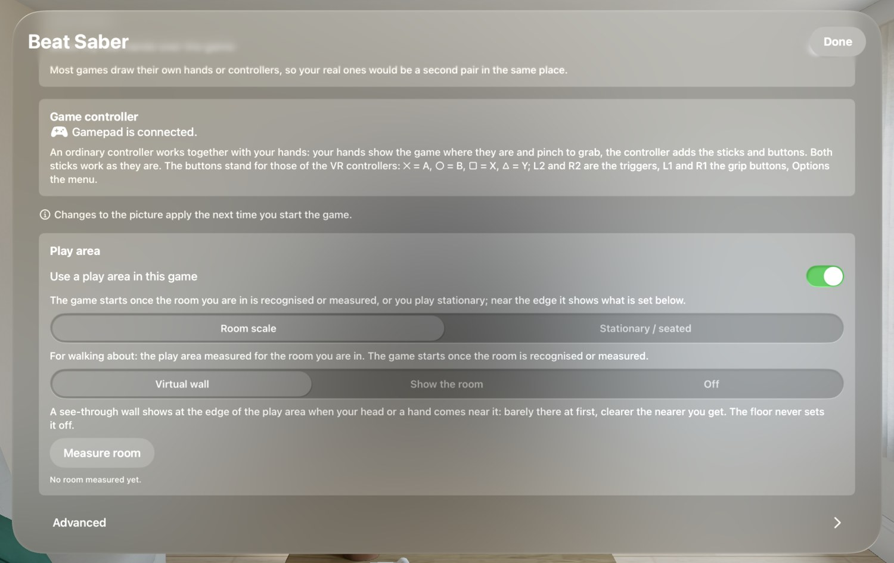

🏠 [Übersicht / Overview](README.md) · 🇩🇪 [Deutsche Fassung](Spielbereich.md)

# Play area (measure room)

So that you don't walk into furniture or walls while playing, the games know your room – much like on a Meta Quest. At the edge of your play area, a see-through wall appears.

## Measure once – for all games

You measure a room **only once**. All games AVP Play installs share that room. If you measure in Walkabout, for example, Beat Saber already knows the room afterwards.

In a new room, simply measure again. Up to ten rooms are stored.

## How to measure a room

1. Tap **Measure room** in the start window (or it comes by itself when no room is known yet).
2. **Look around:** Look around slowly, at the floor too. A fine grid shows what has been captured. The card tells you which way something is still missing ("Turn to your left …").
3. **Suggestion:** The app suggests the largest free floor around you (25 cm away from furniture). It appears as a line on the floor.
4. Choose:
   - **Fits — save**
   - **Scan again**
   - **Draw it myself**

### Drawing it yourself

Point a controller at the floor and hold the trigger (or pinch and drag with a hand). Letting go closes the line.

- **Automatic** (default): If what you circle lies mostly outside your area, it is added. If it lies mostly inside, it is cut out.
- **Add** / **Cut out**: always one or the other.
- **Undo**, **Clear**, **Done**.

Holes and separate islands never stay – the area you stand in is what counts.

## What happens when you press Start

When you tap **Start**, the game checks **silently in the background** which room you are in. The start window briefly shows "Finding the room …". When the room is recognised, the game starts right away – you don't see anything else.

Only if the room isn't recognised after about **8 seconds** does a card appear in the room:

- **Measure room** – measure this room again
- **Stationary / seated** – play without a room
- **Cancel**

The search goes on behind the card – if the room is recognised after all, the game still starts.

## In the game

When your head (about 35 cm) or a hand (about 25 cm) comes close to the edge, a see-through wall appears – barely visible at first, clearer the closer you get. The floor and tables never set it off.

In the game's settings you can choose **Show the room** instead of the wall: the game then turns see-through near the edge and you see your real room. (This only works with the frame rate *Up to 100*.)

## Stationary / seated

For games played standing on the spot or seated: instead of a measured room, there is a circle of 1.5 m around your head. Nothing to measure.

## Turning it off

**For one game:** In the start window, turn off **Settings › Play area › Use a play area in this game**. Then there is no check at the start and nothing near the edge.

**For all new games:** In AVP Play on the Mac, turn off **Settings › Play area › Measure room in the games that are installed**. This applies to games you install or update afterwards. For games already installed, turn it off in the game itself (see above).

## "Surroundings" permission

To measure, the game needs permission to sense your surroundings. The Vision Pro asks once. If you declined: **Settings › Privacy & Security › Surroundings** and allow the game there.

---

➡️ [Controls and controllers](Controls.md)
