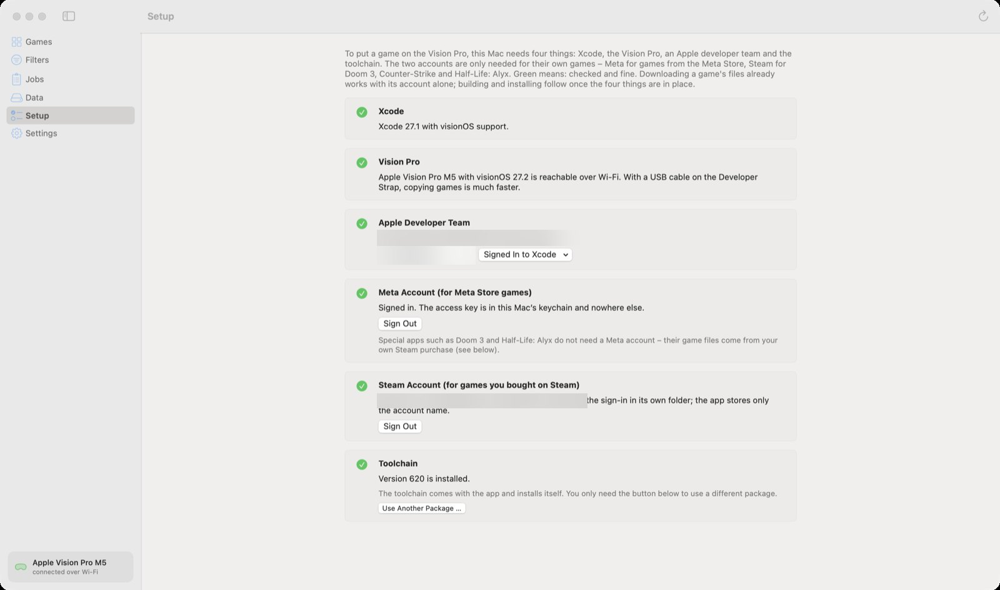

🏠 [Übersicht / Overview](README.md) · 🇩🇪 [Deutsche Fassung](Einrichtung.md)

# Setup

The **Setup** page in the app shows what is still missing. A **green tick** means: checked and fine. An **orange triangle** is a note (for example: free Apple account). An **empty circle** means: still missing.

Your Mac always needs four things: **Xcode**, the **Vision Pro**, an **Apple developer team** and the **toolchain**. You only need the **Meta account** and the **Steam account** for games from those stores.

After each change you can click **Check Again** (the circular arrow, top right).

---

## 1. Install Xcode

Xcode is Apple's free app for developers. AVP Play needs it to build the games for the Vision Pro. You don't have to use Xcode yourself – it just has to be installed.

1. Open the **App Store** on your Mac and search for **Xcode**. Download and install it (it takes a while, Xcode is big).
2. **Open Xcode once.** Confirm whatever it asks on first launch.
3. If Setup says the **visionOS platform** is missing: in Xcode open **Settings › Components** and download **visionOS**.

## 2. Sign in to your Apple account in Xcode

1. In Xcode: **Settings › Accounts**.
2. Click **+** at the bottom left, choose **Apple ID** and sign in with your Apple ID.
3. Back in AVP Play, click **Check Again**. Your name appears under **Apple Developer Team**. If you have several teams, choose one in the **Signed In to Xcode** menu.

### Apple account: free or paid?

Both work.

| | Free account (your normal Apple ID) | Paid membership (Apple Developer Program) |
|---|---|---|
| How long does a game open? | **7 days**, then it has to be signed again | **1 year** |
| Apps on the Vision Pro at the same time | **At most 3** | no limit |
| New games per week | at most 10 | no limit |
| Cost | none | yearly fee to Apple |

With a free account, the app shows a small "Free Apple account" box at the bottom of the sidebar, for example "2 of 3 apps · 7 days each".

**Tip for the free account:** Turn on **Settings › Renew signatures**. The app then signs your games again by itself before the 7 days are up – as long as the Vision Pro is on and on the same Wi-Fi. Saved games stay.

**Needed once with a free account:** Trust the developer on the Vision Pro: **Settings › General › VPN & Device Management**, choose your Apple account and tap **Trust**.

## 3. Connect the Vision Pro (once)

1. Put the Vision Pro and the Mac on the **same Wi-Fi**.
2. On the Vision Pro: open **Settings › General › Remote Devices**. Leave that page open.
3. On the Mac, in Xcode: open **Window › Devices and Simulators**, select the Vision Pro, click **Pair** and enter the code shown in the headset.
4. On the Vision Pro: turn on **Settings › Privacy & Security › Developer Mode** and restart when asked.

Afterwards the Vision Pro only has to be **on, unlocked and on the same Wi-Fi**. The bottom of the app's sidebar shows whether it is connected ("connected over Wi-Fi").

**Faster copying:** With the Developer Strap and a USB cable, copying big games is much faster. The app uses the cable by itself.

## 4. Sign in to Meta (for Meta Store games)

Signing in uses a small tool from Meta called **ovr-platform-util**. It is free, but Meta only offers it on its own page. So it takes two clicks:

1. In Setup, click **1 Open Meta's Download Page** and download the **macOS** version there.
2. AVP Play finds the file in your **Downloads** folder by itself (or click **2 Find the Download**). You don't have to move the file.
3. Click **Sign In …** and answer the questions in the window (e-mail, password, maybe a code).

Your access key is only stored in your Mac's keychain and only sent to Meta.

**If macOS blocks the tool:** Open **System Settings › Privacy & Security**, scroll down and click **Open Anyway** next to *ovr-platform-util*. Then choose **Try Again** in the app.

## 5. Sign in to Steam (optional)

Only needed for games you bought on Steam – for example **Half-Life: Alyx**, **Doom 3**, **Counter-Strike**, or if you bought **Walkabout Mini Golf** or **Moss** on Steam.

1. **Get SteamCMD from Valve** – Valve's own sign-in tool.
2. If shown: **Install Rosetta**. Valve only makes SteamCMD for Intel Macs; Rosetta lets it run on your Mac.
3. **Sign In …**: enter your Steam **account name** (the name you sign in with – not your profile name), then your password. If Steam Guard is on, type the code or confirm in the Steam app on your phone.

Your password only goes to SteamCMD. The app only stores your account name.

## 6. Toolchain

The **toolchain** is the part that translates a Quest game into a Vision Pro app. It comes with the app and installs itself. Normally there is nothing to do here.

---

## Next

➡️ [Finding and filtering games](Games-and-Filters.md)
