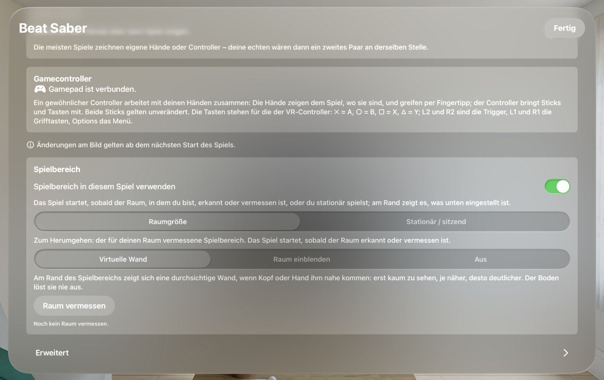

🏠 [Übersicht / Overview](README.md) · 🇬🇧 [English version](Play-Area.md)

# Spielbereich (Raum vermessen)

Damit du beim Spielen nicht gegen Möbel oder Wände läufst, kennen die Spiele deinen Raum – ähnlich wie bei der Meta Quest. Am Rand deines Spielbereichs erscheint eine durchsichtige Wand.

## Einmal vermessen – für alle Spiele

Du vermisst einen Raum **nur einmal**. Alle Spiele, die AVP Play installiert, teilen sich diesen Raum. Misst du zum Beispiel in Walkabout, kennt Beat Saber den Raum danach schon.

In einem neuen Raum misst du einfach noch einmal. Bis zu zehn Räume werden gespeichert.

## So vermisst du einen Raum

1. Im Startfenster auf **Raum vermessen** tippen (oder es kommt von selbst, wenn noch kein Raum bekannt ist).
2. **Umsehen:** Schau dich langsam um, auch auf den Boden. Ein feines Gitter zeigt, was schon erfasst ist. Die Karte sagt dir, in welche Richtung noch etwas fehlt („Dreh dich nach links …“).
3. **Vorschlag:** Die App schlägt die größte freie Fläche um dich herum vor (mit 25 cm Abstand zu Möbeln). Sie erscheint als Linie auf dem Boden.
4. Wähle:
   - **Passt – speichern**
   - **Neu scannen**
   - **Selbst zeichnen**

### Selbst zeichnen

Zeig mit einem Controller auf den Boden und halte den Abzug gedrückt (oder mit der Hand zusammenkneifen und ziehen). Loslassen schließt die Linie.

- **Automatisch** (Standard): Liegt das Umrandete größtenteils außerhalb deines Bereichs, kommt es dazu. Liegt es größtenteils darin, wird es herausgeschnitten.
- **Hinzufügen** / **Herausschneiden**: immer das eine oder das andere.
- **Rückgängig**, **Alles löschen**, **Fertig**.

Löcher und einzelne Inseln bleiben nie – es zählt immer die Fläche, in der du stehst.

## Was beim Starten passiert

Wenn du auf **Starten** tippst, prüft das Spiel **still im Hintergrund**, in welchem Raum du bist. Im Startfenster steht kurz „Raum wird erkannt …“. Wird der Raum erkannt, startet das Spiel sofort – ohne dass du etwas siehst.

Nur wenn der Raum nach etwa **8 Sekunden** nicht erkannt wird, erscheint eine Karte im Raum:

- **Raum vermessen** – diesen Raum neu vermessen
- **Stationär / sitzend** – ohne Raum spielen
- **Abbrechen**

Die Suche läuft hinter der Karte weiter – wird der Raum doch noch erkannt, startet das Spiel trotzdem.

## Im Spiel

Kommst du mit dem Kopf (ca. 35 cm) oder einer Hand (ca. 25 cm) dem Rand nahe, erscheint eine durchsichtige Wand – erst kaum zu sehen, je näher, desto deutlicher. Der Boden und Tische lösen sie nie aus.

In den Einstellungen des Spiels kannst du statt der Wand auch **Raum einblenden** wählen: Dann wird das Spiel am Rand durchsichtig und du siehst deinen echten Raum. (Das geht nur bei der Bildrate *Bis 100*.)

## Stationär / sitzend

Für Spiele im Stehen auf der Stelle oder im Sitzen: Statt eines vermessenen Raums gibt es einen Kreis von 1,5 m um deinen Kopf. Nichts zu vermessen.

## Ausschalten

**Für ein Spiel:** Im Startfenster **Einstellungen › Spielbereich › Spielbereich in diesem Spiel verwenden** ausschalten. Dann gibt es keine Prüfung beim Start und nichts am Rand.

**Für alle neuen Spiele:** In AVP Play auf dem Mac unter **Einstellungen › Spielbereich** den Schalter **„Raum vermessen“ in den Spielen, die installiert werden** ausschalten. Das gilt für Spiele, die du danach installierst oder aktualisierst. Bei schon installierten Spielen schaltest du es im Spiel selbst aus (siehe oben).

## Erlaubnis „Umgebung“

Zum Vermessen braucht das Spiel die Erlaubnis, die Umgebung zu erfassen. Die Vision Pro fragt einmal danach. Hast du abgelehnt: **Einstellungen › Datenschutz & Sicherheit › Umgebung** und dort das Spiel erlauben.

---

➡️ [Steuerung und Controller](Steuerung.md)
