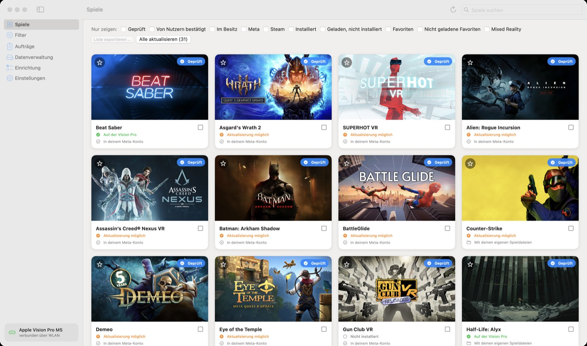
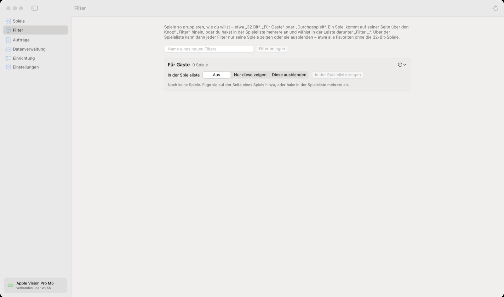

🏠 [Übersicht / Overview](README.md) · 🇬🇧 [English version](Games-and-Filters.md)

# Spiele finden und filtern

Unter **Spiele** siehst du alle Spiele, die AVP Play kennt – die geprüften zuerst, dann die übrigen aus dem Meta-Store. Ganz unten lädt die Liste beim Scrollen weitere Spiele nach.

## Eine Spielkarte

Jedes Spiel hat eine Karte mit:

- **Bild und Name**
- **Stern** oben links: als Favorit merken
- **Etikett** oben rechts: *Geprüft*, *Von Nutzern bestätigt*, *Ungetestet*, *Inkompatibel* oder *2D-App* (2D-Apps wie Spotify oder YouTube laufen nicht – AVP Play ist nur für VR-Spiele)
- **Stand auf der Vision Pro**, zum Beispiel *Auf der Vision Pro*, *Aktualisierung möglich*, *Nicht installiert*
- **Besitz**, zum Beispiel *In deinem Meta-Konto* oder *Nicht in deinem Steam-Konto*
- **Kästchen** rechts: um mehrere Spiele auf einmal auszuwählen

Ein Klick auf die Karte öffnet die [Seite des Spiels](Spielseite.md).

## Suchen

Oben rechts steht das Suchfeld **Spiele suchen**. Tippe einen Teil des Namens ein. Nach kurzer Pause sucht die App auch im Online-Katalog mit allen Spielen aus dem Meta-Store.

## Filter „Nur zeigen“

Über der Liste stehen Häkchen. Jedes Häkchen zeigt nur bestimmte Spiele. Mehrere Häkchen zusammen machen die Liste kleiner.

| Filter | Zeigt nur … |
|---|---|
| **Geprüft** | Spiele, die das Projekt getestet hat |
| **Von Nutzern bestätigt** | Spiele, die laut anderen Nutzern laufen |
| **Im Besitz** | Spiele, die dir gehören (Meta-Bibliothek und Steam-Konto) |
| **Meta** | Spiele aus dem Meta-Store |
| **Steam** | Spiele, die es bei Steam gibt (siehe [Spiele von Steam](Steam-Spiele.md)) |
| **Installiert** | Spiele, die auf deiner Vision Pro sind |
| **Geladen, nicht installiert** | Spiele, deren Dateien schon auf dem Mac sind, aber nicht auf der Vision Pro |
| **Favoriten** | Spiele mit Stern |
| **Nicht geladene Favoriten** | Favoriten, deren Dateien noch geladen werden müssen |
| **Mixed Reality** | Spiele, bei denen du deinen echten Raum um das Spiel herum siehst |

*Geprüft* und *Von Nutzern bestätigt* zusammen zeigen beides. Das Gleiche gilt für *Meta* und *Steam*.

**Im Besitz** braucht die Anmeldung bei Meta bzw. Steam. Die App liest deine Bibliothek höchstens einmal pro Stunde (Meta) bzw. einmal am Tag (Steam).

## Eigene Filter

Du kannst Spiele so gruppieren, wie du willst – zum Beispiel „Für Gäste“, „32 Bit“ oder „Durchgespielt“.

**So legst du einen Filter an:**

1. Links auf **Filter** klicken.
2. Einen Namen eintippen und **Filter anlegen** klicken.

**So kommt ein Spiel in den Filter:**

- Auf der Seite des Spiels auf den Knopf **Filter** klicken und den Filter anhaken, **oder**
- in der Spieleliste mehrere Spiele anhaken und unten in der Leiste **Filter …** wählen.

**So benutzt du ihn:** Über der Spieleliste steht dann eine Zeile **Eigene Filter**. Ein Klick auf einen Filter schaltet weiter zwischen **Aus**, **Nur diese zeigen** und **Diese ausblenden**. Ausgeblendete Filter sind durchgestrichen.

Beispiel: *Favoriten* anhaken und den Filter „32 Bit“ auf *Diese ausblenden* stellen – schon siehst du alle Favoriten ohne die 32-Bit-Spiele.

Auf der Seite **Filter** kannst du einen Filter auch umbenennen, löschen (die Spiele bleiben) oder als Liste speichern.

## Mehrere Spiele auf einmal

Hake die Kästchen mehrerer Spiele an. Unten erscheint eine Leiste mit:

- **Installieren** – lädt, baut und installiert die Spiele nacheinander
- **Nur herunterladen** – lädt nur die Dateien auf den Mac (dafür braucht es weder Xcode noch die Vision Pro)
- **Filter …** – die Spiele einem eigenen Filter zuordnen
- **Auswahl aufheben**

## Alle aktualisieren

Der Knopf **Alle aktualisieren (Zahl)** baut alle installierten Spiele neu, für die es einen neueren Stand gibt – zum Beispiel nach einem Update von AVP Play. Spielstände und Daten auf der Vision Pro bleiben dabei erhalten.

## Liste exportieren

**Liste exportieren …** speichert die gerade gezeigten Spiele als Textdatei. Das geht, wenn ein Filter wie *Installiert*, *Favoriten* oder ein eigener Filter auf *Nur diese zeigen* gesetzt ist.

---

➡️ [Die Seite eines Spiels](Spielseite.md)
