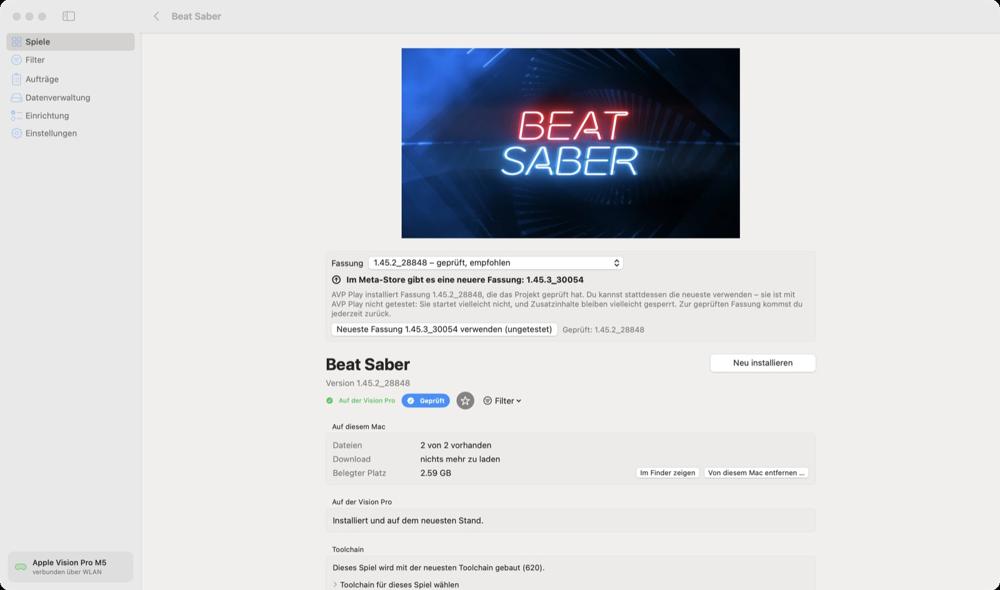
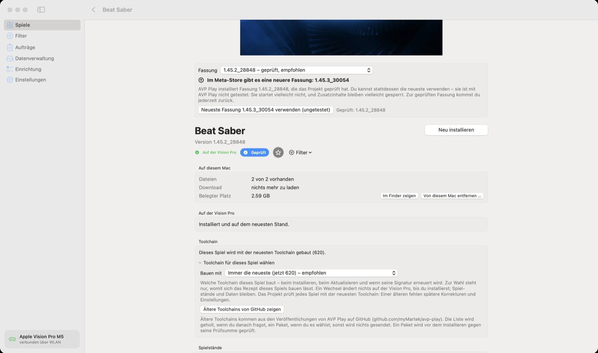
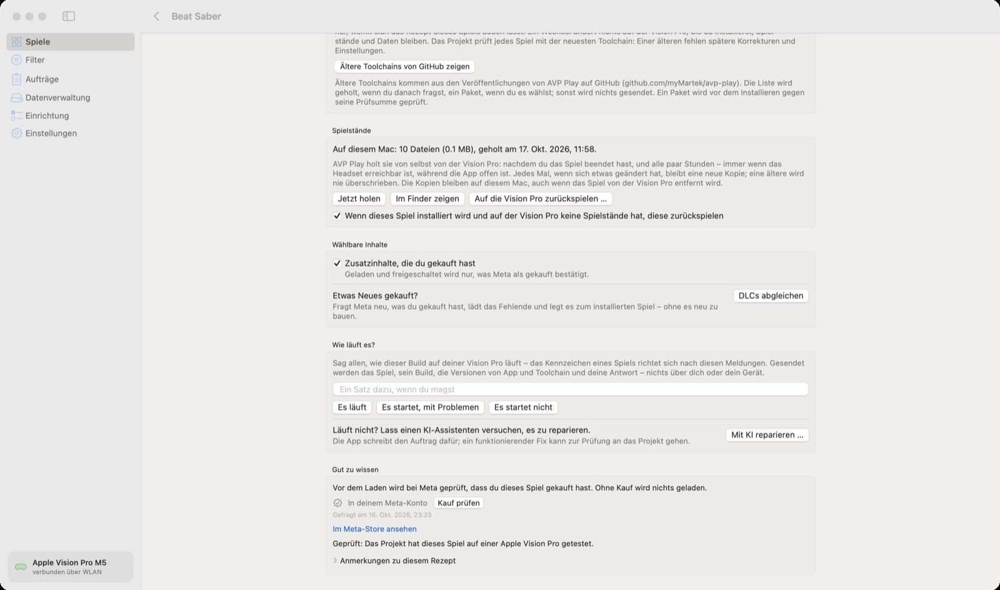

🏠 [Übersicht / Overview](README.md) · 🇬🇧 [English version](Game-Page.md)

# Die Seite eines Spiels

Ein Klick auf ein Spiel in der Liste öffnet seine Seite. Hier installierst du es, wählst die Fassung, sicherst Spielstände und meldest, wie es läuft.

## Der große Knopf

Rechts neben dem Namen steht der Hauptknopf:

- **Installieren** – das Spiel ist noch nicht auf der Vision Pro.
- **Aktualisieren** – es gibt einen neueren Stand (neue Toolchain oder neue Spielfassung). Spielstände und Daten bleiben erhalten.
- **Neu installieren** – alles ist aktuell; baut das Spiel trotzdem neu.

Ist der Knopf grau, steht darunter, warum (zum Beispiel „Die Apple-Team-ID fehlt noch“ oder „Nicht genug freier Platz“).

**Nur herunterladen** lädt nur die Dateien auf den Mac – ohne Xcode, ohne Vision Pro. Später geht das Installieren dann ohne neues Laden.

## Gekauft bei (Meta-Store oder Steam)

Nur bei Spielen, die es in beiden Shops gibt (zurzeit **Walkabout Mini Golf** und **Moss**). Wähle, wo du das Spiel gekauft hast. Die App merkt das meist selbst: Gehört dir das Spiel nur bei Steam, stellt sie auf Steam um.

Wichtig: Die Meta- und die Steam-Fassung sind verschiedene Apps mit eigenen Spielständen. Die eine lässt sich nicht über die andere installieren – erst die alte auf der Vision Pro entfernen. (Die Spielstände, die AVP Play schon auf den Mac geholt hat, bleiben dort.)

## Fassung

Im Menü **Fassung** wählst du die Version des Spiels.

- **geprüft, empfohlen** – diese Version hat das Projekt getestet. Am besten diese nehmen.
- **neueste im Store / ungetestet** – neuere Versionen aus dem Meta-Store. Sie können laufen, müssen aber nicht; Zusatzinhalte können gesperrt bleiben. Du kannst jederzeit zur geprüften Version zurück.

Hat der Store eine neuere Version, zeigt die App einen Hinweis mit dem Knopf **Neueste Fassung … verwenden (ungetestet)**.

## Auf diesem Mac / Auf der Vision Pro

- **Auf diesem Mac:** wie viele Dateien schon da sind, was noch zu laden ist und wie viel Platz das Spiel belegt. **Von diesem Mac entfernen …** löscht die geladenen Dateien (das Spiel auf der Vision Pro bleibt).
- **Auf der Vision Pro:** ob das Spiel installiert und aktuell ist. Mit einem kostenlosen Apple-Konto steht hier auch, bis wann sich das Spiel öffnen lässt.

## Toolchain

Normalerweise wird jedes Spiel mit der neuesten Toolchain gebaut – das ist gut so. Unter **Toolchain für dieses Spiel wählen** kannst du ein Spiel auf einer älteren Toolchain lassen, falls ein Update bei genau diesem Spiel etwas schlechter macht. **Ältere Toolchains von GitHub zeigen** lädt ältere Versionen nach, wenn du eine auswählst.

Das ist für Fortgeschrittene. Im Zweifel: **Immer die neueste – empfohlen**.

## Spielstände

AVP Play holt die Spielstände deiner Spiele von selbst auf den Mac – nachdem du ein Spiel beendet hast und alle paar Stunden. Jede Änderung bleibt als eigene Kopie erhalten.

- **Jetzt holen** – sofort sichern
- **Im Finder zeigen** – den Ordner mit den Sicherungen öffnen
- **Auf die Vision Pro zurückspielen …** – eine Sicherung zurück auf die Vision Pro bringen. Was dort gerade liegt, wird vorher noch auf den Mac kopiert, damit nichts verloren geht. **Vorher das Spiel beenden.**
- Das Häkchen darunter sorgt dafür, dass ein neu installiertes Spiel ohne Spielstände automatisch deine letzte Sicherung bekommt.

Half-Life: Alyx ist hier nicht dabei – es nutzt die Steam Cloud (siehe [Auf der Vision Pro](Auf-der-Vision-Pro.md#half-life-alyx)).

## Wählbare Inhalte

- **Zusatzinhalte, die du gekauft hast** – zum Beispiel Song-Pakete in Beat Saber oder Bahnen in Walkabout. Nur was Meta (oder Steam) als gekauft bestätigt, wird geladen.
- **Etwas Neues gekauft? › DLCs abgleichen** – fragt Meta neu, lädt nur das Neue und fügt es dem installierten Spiel hinzu, ohne neu zu bauen. Danach das Spiel neu starten.
- **Sprachen** – bei manchen Spielen sind weitere Sprachen ein eigener Download.
- **Sonderinhalte** – zum Beispiel bei Half-Life: Alyx die deutsche Sprachausgabe (Fan-Mod).

## Wie läuft es?

Hier sagst du allen anderen, wie das Spiel bei dir läuft: **Es läuft**, **Es startet, mit Problemen** oder **Es startet nicht** – gern mit einem Satz dazu. Danach richten sich die Etiketten in der Spieleliste. Geschickt wird nur das Spiel, seine Version, die Versionen von App und Toolchain und deine Antwort – nichts über dich oder dein Gerät.

### Mit KI reparieren

Läuft ein Spiel nicht, kannst du einen KI-Assistenten (zum Beispiel ChatGPT oder Claude) versuchen lassen, es zu reparieren:

1. **Mit KI reparieren …** klicken.
2. Ankreuzen, was passiert (stürzt ab, bleibt schwarz, Bild falsch, Steuerung geht nicht …), optional beschreiben.
3. **Auftrag kopieren** und den Text in deinen KI-Assistenten einfügen.

AVP Play selbst schickt dabei nichts weg. Das ist eher etwas für Neugierige mit etwas Geduld.

## Gut zu wissen

- **Kauf prüfen** – fragt sofort bei Meta (und Steam) nach, ob dir das Spiel gehört. Nützlich, wenn du es gerade gekauft hast.
- **Im Meta-Store ansehen / Bei Steam ansehen** – öffnet die Shop-Seite.
- **Anmerkungen zu diesem Rezept** – Hinweise des Projekts zu genau diesem Spiel.

## Spiele, für die du die Dateien selbst bereitstellst

**Doom 3**, **Counter-Strike** und **Half-Life: Alyx** kommen nicht aus dem Meta-Store. Ihre Dateien holt die App aus deinem Steam-Kauf (**Von Steam laden**) – oder du zeigst ihr mit **Ordner auswählen …** einen Ordner, in dem die Dateien schon liegen.

---

➡️ [Spiele von Steam](Steam-Spiele.md)
