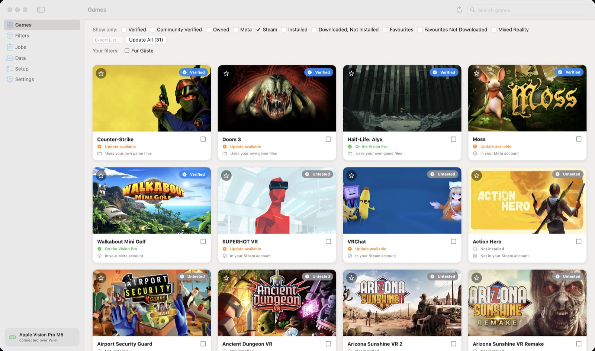
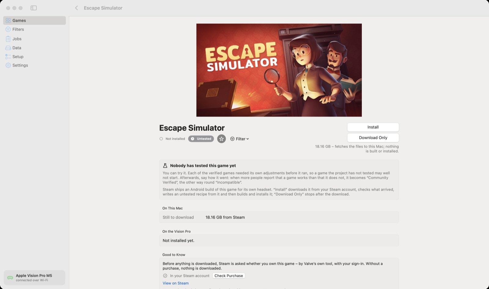

🏠 [Übersicht / Overview](README.md) · 🇩🇪 [Deutsche Fassung](Steam-Spiele.md)

# Games from Steam

Many VR games are also sold on Steam – some of them with an Android build that Steam ships for its own headset. AVP Play can download such games from **your own Steam purchase** and put them on the Vision Pro.

You need the Steam sign-in under [Setup](Setup.md#5-sign-in-to-steam-optional).

## Showing Steam games

Tick **Steam** above the game list. You then see:

- games sold on Steam that the project knows (for example Walkabout Mini Golf, Moss, Half-Life: Alyx)
- the Steam games **in your account** that have an Android build
- other known Steam games with an Android build, marked *Not in your Steam account*

## Installing a Steam game

- **Install** downloads the game from your Steam account, checks every file, writes a recipe for it and then builds and installs it like any other game.
- **Download Only** stops after the download.

Such games are usually **Untested**. They are worth a try – but every verified game needed its own adjustments, so it may not start.

## Bought on Steam instead of Meta

If you bought **Walkabout Mini Golf** or **Moss** on Steam, choose **Purchased from: Steam** on the game's page. The Steam version is a separate app with its own saved games.

## Half-Life: Alyx, Doom 3, Counter-Strike

These games don't run as Quest games but through their own routes:

- **Half-Life: Alyx** – the Linux build (about 73 GB) from your Steam purchase. Optionally with a German voice-over (fan mod). Saved games through Steam Cloud.
- **Doom 3** and **Counter-Strike** – the game files from your Steam purchase (or from a folder).

On the game's page, **You Provide These Files Yourself** lists what is missing. **Download from Steam** fetches it.

## Privacy

The app asks which games you own on Steam with Valve's own tool (SteamCMD) – at most once a day. No third-party service learns what you own.

---

➡️ [Jobs](Jobs.md)
