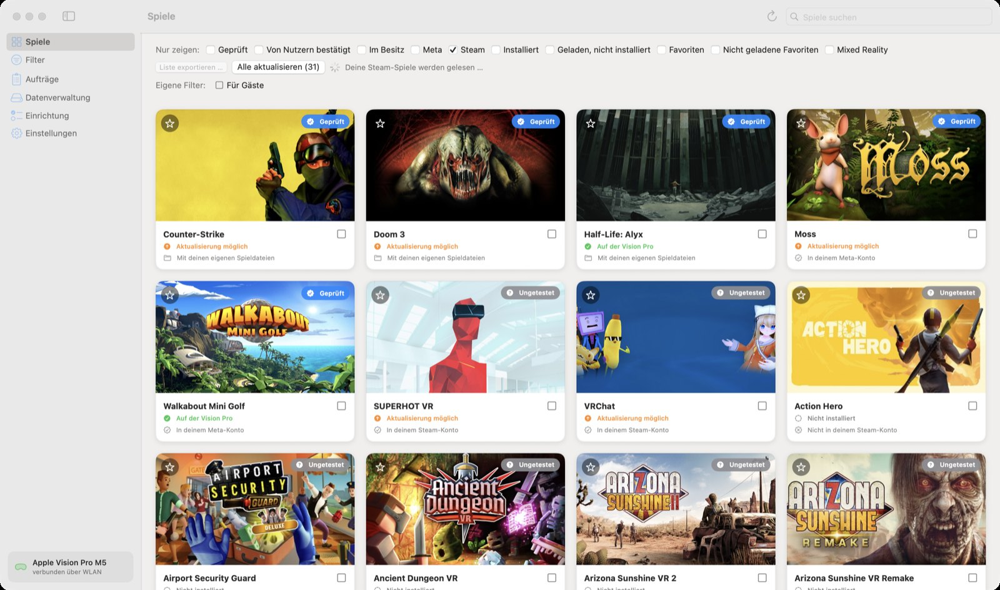
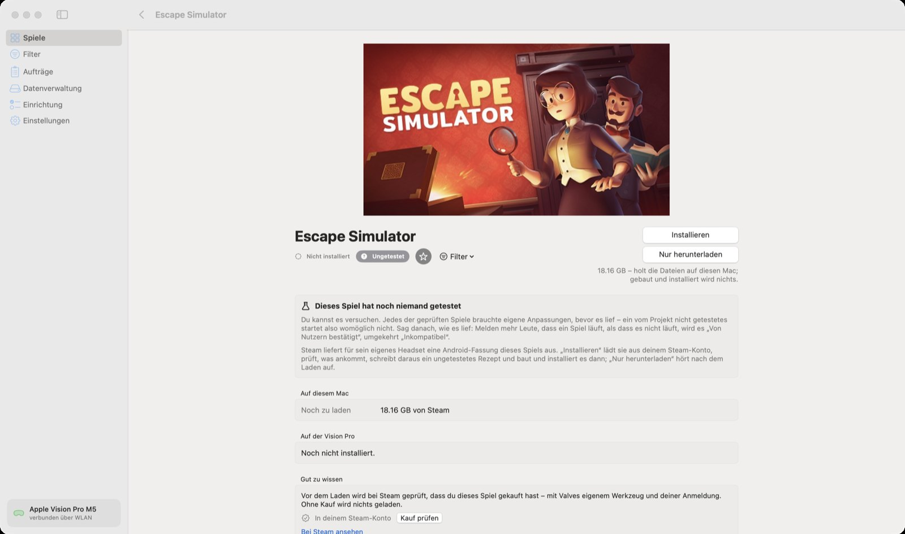

🏠 [Übersicht / Overview](README.md) · 🇬🇧 [English version](Steam-Games.md)

# Spiele von Steam

Viele VR-Spiele gibt es auch bei Steam – manche davon mit einer Android-Fassung, die Steam für sein eigenes Headset ausliefert. AVP Play kann solche Spiele aus **deinem eigenen Steam-Kauf** laden und auf die Vision Pro bringen.

Dafür brauchst du die Steam-Anmeldung unter [Einrichtung](Einrichtung.md#5-steam-konto-anmelden-optional).

## Steam-Spiele anzeigen

Hake über der Spieleliste **Steam** an. Dann siehst du:

- Spiele, die es bei Steam gibt und die das Projekt kennt (zum Beispiel Walkabout Mini Golf, Moss, Half-Life: Alyx)
- die Steam-Spiele **in deinem Konto**, die eine Android-Fassung haben
- weitere bekannte Steam-Spiele mit Android-Fassung, markiert mit *Nicht in deinem Steam-Konto*

## Ein Steam-Spiel installieren

- **Installieren** lädt das Spiel aus deinem Steam-Konto, prüft jede Datei, schreibt dafür ein Rezept und baut und installiert es dann wie jedes andere Spiel.
- **Nur herunterladen** hört nach dem Laden auf.

Solche Spiele sind meist **Ungetestet**. Probieren lohnt sich – aber jedes geprüfte Spiel brauchte eigene Anpassungen, also kann es auch sein, dass es nicht startet.

## Gekauft bei Steam statt bei Meta

Hast du **Walkabout Mini Golf** oder **Moss** bei Steam gekauft, wähle auf der Seite des Spiels **Gekauft bei: Steam**. Die Steam-Fassung ist eine eigene App mit eigenen Spielständen.

## Half-Life: Alyx, Doom 3, Counter-Strike

Diese Spiele laufen nicht als Quest-Spiel, sondern über eigene Wege:

- **Half-Life: Alyx** – die Linux-Fassung (etwa 73 GB) aus deinem Steam-Kauf. Optional mit deutscher Sprachausgabe (Fan-Mod). Spielstände über die Steam Cloud.
- **Doom 3** und **Counter-Strike** – die Spieldateien aus deinem Steam-Kauf (oder aus einem Ordner).

Auf der Seite des Spiels steht unter **Diese Dateien stellst du selbst bereit**, was fehlt. **Von Steam laden** holt es.

## Datenschutz

Welche Spiele du bei Steam besitzt, fragt die App mit Valves eigenem Werkzeug (SteamCMD) ab – höchstens einmal am Tag. Kein fremder Dienst erfährt, was du besitzt.

---

➡️ [Aufträge](Auftraege.md)
