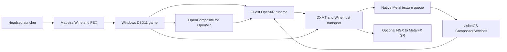

# Windows VR source delivery

See [the current implementation status](windows-vr-status.md) for the source continuation, local library/profiles, transfer, diagnostics, spatial scaling, and remaining delivery gates.

Initial target: M2 Vision Pro, visionOS 27. M5, frame generation and guest-render-pass foveation remain later work. This delivery contains source and integration recipes; no executable app or performance result is established.

## Execution path

FEX translates x64 instructions; native Wine compatibility libraries and Metal rendering execute on the headset. Steam Frame supplies the architectural precedent for separating translated game code from native libraries. Linux Proton binaries are not packaged as visionOS executables. This path does not use a PC streaming server.

## Included source

The app requests Madeira's debugger script through StikDebug/StikJIT, prepares an immersive compositor, selects an owned game folder and launches through an embedded signed framework. The native adapter validates the PE architecture, configures exact arguments, seeds a Wine prefix, chooses matching guest DLLs and calls real Madeira Wine/FEX bridges. It reports Wine process state without claiming that the game rendered.

The OpenVR boundary uses pinned OpenComposite rather than handwritten versioned OpenVR vtables. The project-owned D3D11 OpenXR provider and DXMT extension transport poses, input, haptics and GPU-resident stereo textures. The optional Ext3/V2 path carries array slices and subrectangles without changing the existing V1 records; the native renderer crops/scales those eye regions. The compositor uses predicted ARKit poses, bounded queues and shared-event synchronization. Guest COM resources are resolved in the graphics translation layer; they are never treated as native Objective-C pointers.

The NGX source overlay adapts DXMT's supported Super Resolution interface to native MetalFX. It requires explicit eye identification, correct motion/depth/jitter/exposure and separate temporal histories. OpenXR submission alone cannot prove which earlier NGX output belongs to each eye. Unsupported or ambiguous calls fail instead of sharing stereo history. Frame generation and nonuniform guest rendering are deferred; initial compositor rasterization is uniform. Ordinary Metal bilinear eye scaling is implemented separately from temporal SR, and launcher profiles choose a uniform producer render scale before session creation. Owned snapshots retain the last real eye colors between guest submissions without retaining reusable guest swapchain images.

## Reproducible assembly, deferred

Source caches are pinned by `windows-vr-tools/sources.lock.json`. `prepare_runtime.py` copies Madeira into a separate generated tree, applies app/graphics overlays and retargets build machinery to xros. It does not establish that those sources compile. `build_runtime.sh` refuses execution without an explicit future build opt-in. Do not reuse or relabel native iOS archives.

A future assembly requires a visionOS-capable Xcode SDK, the external LLVM/Windows toolchains described by Madeira, native visionOS Wine/FEX/DXMT archives, Windows OpenComposite/OpenXR DLL builds, and a clean usable Wine prefix template. Stage builtins under `visionos-windows-vr/Resources/Runtime` and matching guest DLLs under `Resources/WindowsVR/Guest/x64`. The XcodeGen project then embeds the native frameworks and both resource trees. Source preparation, project generation and compilation have not been executed.

Archive inspection did not establish a usable nonempty prefix template from the source cache. Resource staging refuses an empty or unsafe template. Packaging requires a clean usable template; that input remains unresolved.

## Practical limits

- D3D11 remains the baseline graphics path. Experimental DXMT D3D12 guest/queue/source integration is described in [windows-vr-d3d12.md](windows-vr-d3d12.md); it requires an explicitly matching native/guest package and is not a game-compatibility promise. Vulkan, arbitrary SteamVR drivers, overlays and general game compatibility remain unsupported.
- Guest composition-depth layers and depth-correct positional reprojection are not delivered. Color stereo submission alone does not establish their correctness.
- Current Madeira integration owns one session per app process. Stop requests cooperative OpenXR exit or cancels startup at safe boundaries; it remains pending while Wine is live. Unresponsive guests and any new session require app restart.
- JIT depends on a paired script-capable debugger and the exact device/OS behavior. Free signing and an account-check change do not grant unrestricted JIT or remove entitlement/provisioning constraints.
- No test, build, benchmark, app launch or installation was authorized. One agent performed an earlier patch applicability dry-run contrary to that instruction; subsequent changes have not been checked that way. All code remains unverified.
- Near-native performance requires future device measurements. M2 memory limits, thermal limits, translation cost, GPU work and compositor deadlines remain unresolved.

Preserve Madeira, Wine, FEX, DXMT, OpenComposite and other dependency licenses and corresponding-source obligations when distributing binaries. The repository's own license does not replace upstream licenses. No game files or proprietary NVIDIA model are delivered.
